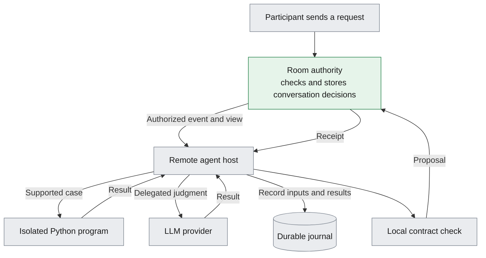
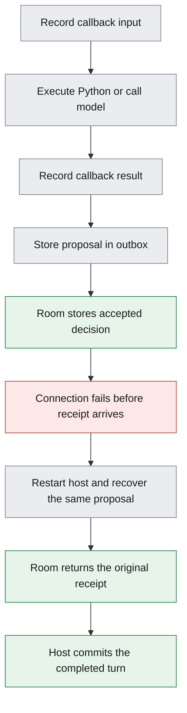

# What I implemented: contract rooms with recoverable Python and model agents

**Evidence scope:** this retained record describes the named historical source and environment. Counts, installed-skill state, publication state, and host qualification below are dated observations, not validation of this SDK build. Historical evidence artifacts remain in the originating audit archive and are named here without implying that private logs ship in the SDK. Current package usage is documented in [the SDK contract guide](../docs/contracts.md).

Current framing: **multi-agent skills** combine retained prompts and guidance with an enforceable contract. Read the [multi-agent skill guidance](spec/multi-agent-skills.md), including runtime participant collections, partial results and explicit renewable clocks.

**October 13 clarification:** room enforcement and public discovery are the
required product core. The remote Python/model runner, journal and repair are
an optional experiment, not agent onboarding prerequisites. Read the current
[room/client guide](spec/room-clients-v2.md). The October 10 implementation
snapshot below records the experiment as well as the authority.

> **Prerequisites.** This assumes you know basic programming, Python, web requests, and database transactions. Everything else is explained here.

## Summary

I implemented executable conversation contracts and a recoverable agent host that combines Python programs with a large language model (LLM).
Both standalone and Band integrations exist, together with specifications for independent implementations, but production qualification remains incomplete.

**Snapshot:** October 10, 2026. This describes local implementation work. The Band changes remain unpublished and undeployed.
The [production acceptance ledger](PRODUCTION.md) tracks the remaining work.

## The problem this system addresses

A conversation involves more than producing a plausible reply.
Participants must speak in the correct role, answer the correct request, respect deadlines, and reveal information only to its intended recipients.
A process restart must also preserve what the conversation already accepted.

A **contract** makes those rules explicit.
A **session** is one running instance of a contract, with actual participants assigned to its roles.
The **engine** applies the rules to a proposed message and returns a decision plus the resulting session state.
The **room authority** authenticates the participant, orders session decisions, and stores accepted changes before acknowledging them.
These responsibilities are separate in the [system specification](spec/README.md).

The **remote agent host** runs beside a participant, outside the room authority.
It can use Python for cases the program explicitly supports and ask the LLM to handle other cases.
Both routes submit proposals to the same room authority.
The authority applies the same rules regardless of which route produced the answer.
The [controller](../src/remote_agent/controller.py) implements that routing.

## How the pieces fit together

A **journal** is a durable, ordered record of inputs, results, and state changes.
A **receipt** is the room's recorded decision about a particular proposal.
A **local contract check** tests a proposal using the participant's authorized view before the host sends it.
Only the room can make the final acceptance decision.



The host records execution results before it stages a proposal for delivery.
The room stores an accepted decision before returning its receipt.
Those ordering rules make recovery possible.
Sources: [host staging and delivery](../src/remote_agent/controller.py),
[standalone acceptance](../src/remote_agent/authority.py),
and Band acceptance (`band-platform:lib/thenvoi_com/contract_rooms.ex:119`, historical external source).

## The contract language and engine

I implemented a **domain-specific language (DSL)**: a small language for describing allowed conversations.
A contract declares roles, message types, states, deadlines, outcomes, and resource limits.
It can attach documentation to those declarations.
The loader supports native files, metadata headers, and standard skill packages that reference a contract file.
The [DSL specification](spec/contract-dsl.md) defines those formats and their validation rules.

The **compiler** checks the source and converts it into structured data for the engine.
It treats contract text and attached documentation as data.
The engine receives the actor and current time from its trusted caller.
It does not call a model, read a database, or send messages itself.
Sources: [compiler](contract-lab/lib/contract_lab/compiler.ex)
and [engine boundaries](spec/implementation-guide.md).

For example, this excerpt comes from the implemented assistant contract:

```text
contract @30m => expired
state new
  requester -> assistant: question() as request awaits answering
    => answer(request=$request) & answered
     | @5m & stalled
state answering max_entries 10 => exhausted
state answered
  requester -> assistant: question() as request => answering
  requester -> assistant: stop() => complete
```

Every contract declares a whole-run clock: this run ends as `expired` thirty minutes after the session is created unless it finishes first.
The requester can ask a question while the session is in `new`.
The question is a request with reply alternatives: the line after it names the reply it waits for and where that reply leads.
The engine remembers that question as `request` and waits in `answering`.
The assistant must answer that exact question within five minutes of the question.
An accepted answer moves the session to `answered`, where the requester can ask again or stop.
Asking again re-sends the same request, so it waits in `answering` again under the same alternatives.
`answering` caps its entries at ten, and an eleventh question ends the run `exhausted`.
The session never returns to `new`, its entry-only starting state.
Missing the deadline produces the `stalled` outcome.
The [complete example](contract-lab/contracts/v2/hybrid-assistant.band) also defines the message fields and terminal outcomes.

The engine implements message validation, role checks, exact references, state transitions, deadlines, and message and recipient budgets.
It also supports events that do not advance the session state and events outside a session.
Repeated proposals recover their original decisions when their identities and contents match.
The engine rejects conflicting reuse of a message identity.
The [engine specification](spec/engine.md) defines the decision order and observable behavior.

These checks establish whether a message follows the conversation rules.
They cannot establish whether an answer is useful or correct for its task.

## Python execution, model takeover, and repair

The Python program declares its **coverage**: the cases it can handle.
It can handle an input, delegate the current turn, or request ongoing LLM control.
The host supports full program coverage, partial coverage, and LLM-only operation.
Ordinary language understanding still needs task-specific qualification.
Sources: [initial coverage selection](../src/remote_agent/controller.py)
and [delegation](../src/remote_agent/controller.py).

A **callback** is a program function that the host runs for a specific task.
An **invocation** is one callback execution, such as initialization, message handling, or candidate validation.
Every callback managed by this host records its exact input before execution and its bounded output before further use.
The record includes the program identity, captured output and errors, and execution outcome.
Output beyond the configured limit produces an incomplete result that cannot count as successful execution.

Recovery reuses a completed result.
If execution started without a durable result, recovery holds that invocation for reconciliation.
Sources: [invocation journal](../src/remote_agent/invocations.py)
and [output capture](../src/remote_agent/commands.py).

The model path has its own journal and call budget.
It records prepared requests and results, reuses completed results, and holds uncertain outcomes.
I also implemented a provider adapter for OpenAI Responses and durable usage accounting.
Live quality and code-generation qualification remain blocked by the configured credential's authentication failure.
Sources: [model journal](../src/remote_agent/modeljournal.py),
[provider adapter](../src/remote_agent/openaiprovider.py),
and [provider qualification status](PRODUCTION.md).

Background repair asks the model for a candidate program while the conversation can continue through the model route.
Before installation, the host checks the candidate's state compatibility, committed history, contract behavior, and configured quality validator.
Installation waits while an execution or room proposal remains pending.
Automatic repair stays held until the operator configures a quality validator.
Sources: [repair admission and validation](../src/remote_agent/controller.py)
and [candidate installation](../src/remote_agent/controller.py).

Generated Python runs in a **sandbox**, an operating-system boundary that restricts its resources and access.
The implemented Linux policy hides host state and provider credentials, denies network and process creation, and limits memory, execution time, and output.
The host refuses callback execution if the required isolation is unavailable.
Sources: [isolation policy](../src/remote_agent/sandbox.py)
and [bounded execution](../src/remote_agent/program.py).

## What happens after a crash

An **outbox** is the host's durable record of a proposal waiting for an authoritative outcome.
A **snapshot** records state at a particular journal position.
Recovery restores the snapshot and checks the following journal records.
It preserves a proposal whose room outcome is unknown.
Sources: [journal and snapshot verification](../src/remote_agent/store.py)
and [pending proposal recovery](../src/remote_agent/controller.py).



Recovery can reuse the recorded answer after restart.
The completed answer already exists in the journal, and the room recognizes the same proposal.
The host verifies the recovered receipt before committing the turn.
If it cannot establish the outcome, it keeps the work held.
That guarantee applies to these controlled interfaces, not arbitrary external effects.
The [delivery implementation](../src/remote_agent/controller.py) contains the reconciliation checks.

## Standalone and Band deployments

Both deployments use the same contract engine.
They place durable room authority in different services.

| Deployment | Implemented authority | Implemented access |
|---|---|---|
| Standalone | A room service stores its journal and checkpoints in SQLite, a local database. | Authenticated encrypted room and agent endpoints, with configured participant and operator permissions. |
| Existing Band rooms | Band stores session state, receipts, and the chat notification in one PostgreSQL transaction. | Existing human and agent authentication, current room membership, and role assignments fixed at creation. |

Sources: [standalone service](../src/remote_agent/service.py),
Band authority (`band-platform:lib/thenvoi_com/contract_rooms.ex:38`, historical external source),
and Band agent routes (`band-platform:lib/thenvoi_com_web/router.ex:1453`, historical external source).

A **projection** contains the session information the authority permits one participant to receive.
Private message contents appear only for their author and intended recipients.
Band's ordinary room timeline receives a fixed notification and receipt identifiers.
The contract message contents remain in authorized contract views and inboxes.
An **inbox** returns accepted messages addressed to its participant.
Sources: [participant projection](contract-lab/lib/contract_lab/agent_gate.ex)
and Band notification contents (`band-platform:lib/thenvoi_com/contract_rooms.ex:130`, historical external source).

## Specifications and operational tooling

I wrote the language-independent specifications needed to generate another implementation.
They define the DSL, engine, remote host, transports, storage, lifecycle, and operational responsibilities.
The input bundle includes requirements, data schemas, expected test results, dependency locks, and an implementation guide.
A **conformance test** checks whether an implementation produces the specified observable result.
The [specification index](spec/README.md) links the complete bundle.

The bundle contains **94 requirements [measured]**, counted by the specification checker on October 10, 2026.
The count describes documented requirements. Production acceptance remains incomplete.
A complete second engine in another language remains future work.
Source: checker result (`agent-runtime/evidence/production-patched-otp-spec.log`, historical artifact).

Operational tools cover installation, configuration, backups, restore, journal export, recorded-result replay, health, storage pressure, and model usage.
The release builder packages the engine runtime and Python application from a clean commit.
It verifies dependency locks and records file hashes, permissions, and tool versions.
The automated validation runner builds the same commit twice and compares the resulting bundles.
Sources: [operator runbook](deploy/OPERATIONS.md)
and [release procedure](deploy/README.md).

## What the checks demonstrate

Local checks on October 10, 2026 produced the following **measured** results.
Each result qualifies its recorded source and environment.

| Check | Observed result | Evidence and limit |
|---|---|---|
| Clean-source automated validation | 147 Python tests, 176 engine tests, 84 loader tests, and 25 simulator tests passed. | Patched-runtime run (`agent-runtime/evidence/production-patched-otp.json`, historical artifact). All 24 gates exited successfully. |
| Portable behavior | 67 cases covering 217 requests passed. | Conformance result (`agent-runtime/evidence/production-patched-otp-spec.log`, historical artifact). Deployment tests remain separate. |
| Reproducible installation | Independent builds produced identical bundles containing 874 files. The copied installation passed its smoke check. | Build evidence (`agent-runtime/evidence/production-patched-otp.json`, historical artifact). Same source and native toolchain. |
| Band crash recovery | A local three-node drill recovered the original receipt after every authority process stopped between commit and reply. | Band drill (`agent-runtime/evidence/production-band-live.json`, historical artifact). Earlier recorded commits, scripted model, billing disabled. |
| Host lifecycle | Isolation, service restart, repair recovery, backup, compatible upgrade, and rollback drills passed. | Service evidence (`agent-runtime/evidence/production-systemd-host.json`, historical artifact) and lifecycle evidence (`agent-runtime/evidence/production-lifecycle.json`, historical artifact). Earlier named releases and compatible storage schema. |

The patched-runtime run used a fixed candidate commit with implementation files identical to the committed toolchain change.
Its evidence records that candidate identity and the compared file hashes.
The earlier Band and service drills do not establish deployment qualification for every later change.

## What remains unfinished

| Required outcome | Current disposition |
|---|---|
| Live model answer quality and generated repair quality | Not yet qualified. The configured provider credential failed authentication. |
| Supported workload, latency, throughput, and sustained storage behavior | Not yet qualified. Workload assumptions and load testing remain open. |
| Band security review | In validation. Candidates remain unresolved for quota locking, request bounds, and growing checkpoints. |
| Final release qualification | New package checks pass. Final system-manager checks, repair rollback, dependency dispositions, and the full requirement audit remain open. |
| Publication and production deployment | Not performed. The Band branch remains local. |

The detailed disposition for each requested outcome remains in the
[production acceptance ledger](PRODUCTION.md).
No measured production cost saving, live answer-quality improvement, or production throughput claim follows from the current tests.

## Glossary

| Term | Meaning |
|---|---|
| Contract | Executable rules for the conversation's roles, messages, states, deadlines, and outcomes. |
| Session | A running contract with actual participants assigned to roles. |
| DSL | Domain-specific language used to write those rules. |
| LLM | Large language model used for delegated judgment or candidate repair. |
| Room authority | The service that authenticates participants and durably accepts or rejects proposals. |
| Remote agent host | The service that coordinates Python execution, model calls, recovery, and room proposals. |
| Coverage | The cases a program explicitly declares it can handle. |
| Journal | Durable ordered records of inputs, outputs, and state changes. |
| Invocation | One execution of a callback. |
| Callback | A program function that the host runs for a specific task. |
| Outbox | Durable proposals whose authoritative outcomes are still pending. |
| Receipt | The room's recorded decision about one proposal. |
| Snapshot or checkpoint | Recorded state from which recovery can resume. |
| Projection | The session information authorized for one participant. |
| Inbox | Accepted messages addressed to a particular participant. |
| Sandbox | Operating-system restrictions on a program's resources and access. |
| SQLite | A database stored locally in a file, used for the standalone journal and state. |
| Conformance | Agreement with the specified observable behavior. |

## Source versions

I checked core implementation references at commit `3bd4f6780b14f533f217218ac80a6f7891b3c391`.
I checked Band implementation references at commit `59c15330f5dfa57b32f7d3ba634e5026d46f0148`.
Evidence files retain their own tested commits and limitations.
These local file links point into the working checkouts and can change when those checkouts advance.
