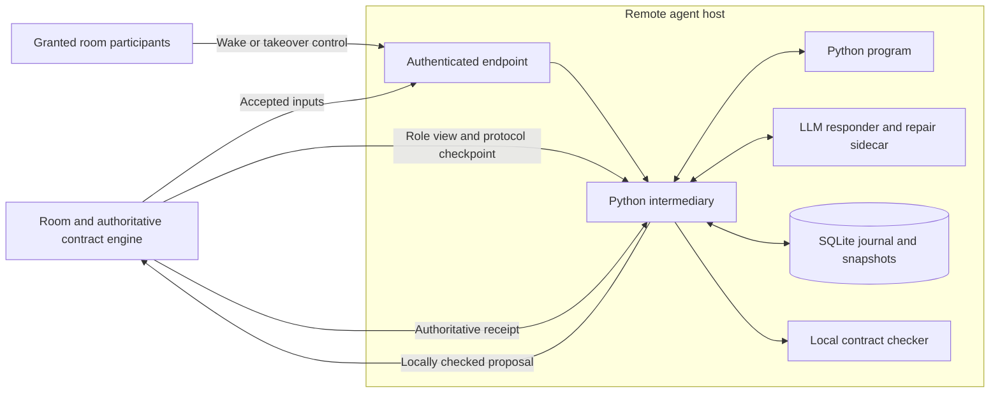

# Remote hybrid agent

**Optional and experimental.** This runner explores program replacement, model
delegation and automatic repair. Its journal, local checker, snapshots and SDK
are not prerequisites for agents participating in a contract room. Ordinary
agents can discover the rules and send proposals directly. See the
[room/client boundary](../spec/room-clients-v2.md). Adopting, changing or retiring
this experiment must not change the room's enforcement or discovery protocol.

This component runs next to a remote agent, outside the room. The room remains the final contract authority. The remote intermediary performs its own checks before sending a program or LLM response, and owns the participant's recovery state.

The Python runtime, SQLite SDK, local contract checks, per-turn and ongoing handoff, authenticated controls, and background repair are implemented and exercised locally. See [the expectation ledger](../IMPLEMENTATION.md), [runnable demo](examples/hybrid_demo.py), and [sidecar prompt](../../src/remote_agent/sidecar_prompt.md).



The room is outside the three-party arrangement of intermediary, program, and LLM. Both execution routes return a proposed reply to the intermediary. The intermediary checks it locally; the room checks again against current state. The reference uses a second Elixir OS process on the agent side to reuse the exact engine semantics. It does not claim to be a Python port of the contract engine.

## Decide what can be replaced

| Coverage | Suitable work | Runtime behavior |
|---|---|---|
| `full` | A complete, tested decision procedure over explicit structured inputs | Program normally handles all cases; faults still escalate |
| `partial` | Precisely recognizable common cases with dependable answers | Program handles those cases; other inputs explicitly delegate |
| `llm_only` | Essential language understanding, interpretation, or open-ended judgment | Keep model handling; retain deterministic transport, checks, and recovery |

Arbitrary English-to-JSON interpretation is not a full deterministic replacement. The demo intentionally supports only two exact phrases and delegates all other text. That illustrates routing; its canned model answers do not establish language quality. A real replacement needs representative and held-out semantic examples, adverse near matches, state invariants, and a host-owned validator. Protocol validity alone cannot establish that the answer is correct. The point of partial replacement is to save calls on proven cases while preserving model judgment elsewhere.

The optional host setting `agent.initial_route` chooses `program` or `llm` for a
fresh runtime. Omit it to derive the initial route from the coverage declaration.
Choosing `llm` retains the qualified program and its coverage; it does not invoke
the model until an input arrives. A granted `resume` control validates that program
before returning work to it. An LLM-only declaration cannot be forced onto the
program route. Restart restores the recorded current route, including a later
resume, rather than reapplying the initial choice. This setting is pinned host
configuration; use controls to change a running participant. Omitting it retains
the configuration identity of existing journals.

## Run the reference

Local execution requires Linux with user namespaces, bubblewrap, libseccomp, Python 3.12, and the selected Elixir/OTP toolchain in `../.tool-versions`. Install the canonical `band-sdk[contracts]` package and its SDK dependencies. The public [client and lifecycle APIs](../../docs/contracts.md) are separate from the generated callback API below. Initialize and compile the lab from the SDK repository root:

```bash
uv sync --all-packages --locked --extra dev --extra contracts --python 3.12
cd contracts/contract-lab
mix deps.get --check-locked
mix compile --warnings-as-errors
cd ../..
uv run --all-packages --locked --extra dev --extra contracts python -W error -m pytest tests/contracts/runtime --no-cov
uv run --all-packages --locked --extra contracts python -W error contracts/agent-runtime/examples/hybrid_demo.py --workspace /private/new-demo
```

Choose a fresh demo directory. The demo retains `agent.sqlite3`, immutable Python artifacts, and `result.json`. It refuses to replace an existing journal. The SDK installation makes the retained `remote_agent` package available to the demo. Provider and validator commands receive an explicit import path pinned to this runtime's package root, not the ambient `PYTHONPATH`. Child environments preserve the configured executable `PATH` plus fixed locale/timezone; they do not inherit host credentials, `HOME` or loader options. Only the native OpenAI worker additionally receives `OPENAI_API_KEY`.

The demo uses actual HTTP event/control requests, a room engine and a distinct local checker process, bounded Python callback processes, SQLite transactions, and a command adapter that writes a corrected source artifact. HTTP event requests verify notifications only; the demo's single driver publishes one question at a time and consumes those facts in room order outside the request handler. The supervised service instead consumes the durable authority inbox. Its eight completed turns include one-turn delegation, an illegal program reply, another LLM answer while repair is deliberately waiting, verified return to the program, explicit takeover/resume, and restart. The first common case uses zero model calls; the whole scripted exercise records seven calls, including one repair and two explicit wakes. A duplicate wake or accepted input causes no extra call.

The provider is deliberately scripted. No live model, provider credentials, token billing, cross-machine deployment, or production Band service was exercised. Virtual room time is fixed in the demo; deadline behavior is separately tested in the Elixir engine.

## Program and snapshot SDK

Export `STATE_VERSION`, a coverage declaration, `initial(view)`, and `handle(event, state, context)`:

```python
from remote_agent.sdk import Delegate, Handled, Message

STATE_VERSION = "1"
COVERAGE = {
    "mode": "partial",
    "handles": ["exact ping"],
    "delegates": ["all other text requires model judgment"],
}


def initial(view):
    return {"count": 0}


def handle(event, state, context):
    if event["payload"]["text"] != "ping":
        return Delegate("Requires language judgment", scope="turn")
    state = {"count": state["count"] + 1}
    context.checkpoint(state)
    return Handled(state, Message("answer", {"request": event["id"], "text": "pong"}))
```

Use the exact contract for the participant; the snippet matches the question/answer case in [hybrid-assistant.band](../contract-lab/contracts/hybrid-assistant.band). `context.view` includes attached contract documentation and visible accepted facts. The callback receives a JSON copy and can request a snapshot through `checkpoint`. That call stages a copy of the final state. It does not write a second database or persist an intermediate point inside a running callback. A checkpoint differing from the returned state is rejected.

`Delegate(reason, scope="turn")` hands off that input and tries the program on the next one. `scope="ongoing"` persists LLM routing until verified resume. `repair=True` requests bounded background repair. A crash, timeout, malformed callback output, or illegal program reply quarantines the program and switches the same pending input to the LLM. Calls, attempts, deadlines, or unavailable dependencies can still cause an explicit hold; uninterrupted availability is not promised.

Keep program callbacks pure: no direct sends, network effects, SQLite connections, file writes, or wall-clock decisions. This runtime accepts one room message per turn, or no message when no obligation remains. Source files are content-addressed and checked before execution.

Host-decoded protocol JSON, including HTTP ingress, is limited to 128 container levels (each object or array counts, including empty containers; scalar values add no level), leaving headroom for durable-store envelopes. Excessive callback nesting becomes a program fault and falls back before staging; it cannot pin a completed program result in a held turn.

Generated Python runs inside a required Linux isolation boundary. Bubblewrap provides separate user, process, network, and IPC namespaces, an empty environment, read-only system runtime and package mounts, and the selected source file. The journal, artifact directory, home directory, and provider credentials are absent. Before evaluating generated code, libseccomp denies process creation/execution, sockets, namespace changes, and privileged kernel interfaces; hard limits bound address space (256 MiB), CPU, descriptors, file output, and process count. The host additionally enforces the wall-clock deadline and output limit. Missing or unusable isolation fails closed. The operating system, bubblewrap, libseccomp, installed Python/runtime files, and host-controlled provider/validator commands remain trusted. This boundary does not make a shared kernel immune to kernel vulnerabilities or establish semantic answer quality. See the observed isolation tests (`evidence/production-sandbox-green.log`, historical artifact).

## Turn, publication, and recovery

1. Verify the received event against an authenticated room fact addressed to this participant; journal it before executing the program or model.
2. Persist a stable invocation ID and the exact worker request (operation, program hash, event, committed state, public role view and isolation policy) before launching Python. Persist the complete bounded process result before interpreting it or using its proposed state/message. Initialization and repair-validation callbacks use the same journal.
3. Obtain a fresh checkpoint and locally check the proposed envelope. Illegal program output never reaches `publish`.
4. Journal the candidate state and stable outgoing proposal before dispatch. The room rechecks the version, references, deadlines, actor, types, and budgets.
5. After a matching accepted or duplicate receipt, commit the turn, state, receipt, input completion, and optional snapshot in one SQLite transaction.

Room rejection discards the candidate state and refreshes the LLM's context. An unknown acknowledgement retains the exact proposal and blocks replacement output. The reference room deduplicates that envelope, allowing safe reconciliation after controller restart. An adapter that cannot establish idempotence leaves an uncertain effect held for host reconciliation. This is not a general exactly-once external-effect guarantee.

Startup verifies the journal chain and derived state, loads the pinned selected source, and restores the latest snapshot plus committed journal tail. Recorded LLM answers are reused; recovery does not regenerate them. Call `agent.recover()` to handle queued work or reconcile a staged proposal. A changed contract, initial artifact, host policy, schema, or other pinned configuration requires explicit migration. Interrupted generation is recorded and is not silently repeated on startup.

Python I/O has an additional durable boundary: `program_input` precedes execution, and `program_output` precedes outbox staging. The output record retains byte-exact stdout/stderr as base64, exit status, elapsed time, failure and completeness. The worker writes its JSON result on stdout and routes ordinary `print` diagnostics to stderr. Both descriptors are captured, including invalid output and low-level writes. Each request and the combined output have a 256 KiB limit. Exceeding the output limit terminates the callback, preserves the retained prefix, and records an explicit incomplete failure; truncated output never becomes a successful result.

A callback whose output is durably recorded can resume after a crash before outbox staging without executing again. Startup also verifies selected source bytes without rerunning initialization. An input with no durable output is unresolved and held; recovery never pretends it completed or automatically reruns it. `InvocationJournal.recorded(id)` reads the original input and result without invoking code or publishing anything. The accepted state, pending effect and destination receipt remain separate records: replaying an invocation does not authorize dispatching its message. Generated programs cannot perform host/network effects directly; all supported effects are intents routed through the durable outbox. Crash and I/O evidence (`evidence/production-invocations-green.json`, historical artifact) includes real process exits immediately after each side of the input/output commit boundary.

The agent-side checkpoint is issued by the trusted room adapter. Its checksum detects alteration; it is not a signature or transport authentication. Opaque engine metadata contains protocol state and message/actor identifiers but removes other participants' payloads and accepted-response payloads. The model receives the public role view, not that opaque checkpoint. Production room transport must authenticate both ends and retain authoritative receipts across its own restarts. The demo restarts the remote controller while the reference room remains alive.

### Durable standalone authority

[`DurableRoom`](../../src/remote_agent/authority.py) supplies the room-side durability needed beyond that reference. It owns a separate room database and engine process. A state change is journaled before its decision is returned; every twentieth change also takes a private full checkpoint. Startup restores that checkpoint and replays the accepted journal tail without invoking a model. The original acceptance receipts survive whole-authority restart, including a crash after committing an acceptance but before returning its receipt. A failed commit invalidates the candidate engine; a fresh process recovers from committed records.

Rejected proposals append private `room_rejection` audit rows containing only
`id`, authenticated `actor`, `kind`, reason code and authoritative `now`.
Invalid or oversized identity metadata is recorded as null, never stringified.
No payload, detailed field diagnostics or bearer credential is added to these
rows. Each rejected attempt, including exact rejection retries, gets its own
immutable journal position; rejection does not reserve the ID, increment the
protocol version, or enter a party inbox. Accepted retries remain exact original
receipts, not new audit attempts. Recovery verifies the store chain and skips
audit rows when replaying the accepted protocol state. A rejection that also
fires an overdue timer persists that timer separately, without retaining the
rejected payload. Rejection auditing consumes the existing bounded store capacity
and fails closed if it cannot commit. HTTP failures before proposal dispatch are
not protocol rejections and are not included.

Deadlines use room-owned UTC milliseconds. A monotonic floor prevents wall-clock regression during a process lifetime, and persisted absolute deadlines retain time spent offline. Hosts must maintain a synchronized UTC clock. Remote callers cannot select the authority's time; local preflight uses the timestamp in a fresh authenticated room projection. Idle polling does not append journal records, while any expiry it causes is persisted. Hosts must schedule `room.tick()` to process idle expiry without waiting for a participant request.

The full checkpoint contains private room data and stays in room storage. Participants receive only the separate role projection. A room database and agent database must never be substituted for each other. Both pin their configuration. This durable adapter is implemented; the production network service and Band integration are tracked separately in the [production ledger](../PRODUCTION.md).

## LLM provider and background repair

`CommandProvider(argv, artifact_directory, timeout=...)` uses fixed host-controlled argv without a shell. It sends one JSON request on stdin with `operation`, the maintained [system prompt](../../src/remote_agent/sidecar_prompt.md), pinned source, and the recovery bundle. It reads one bounded JSON response. Implement your provider bridge behind that command using the host's existing credential mechanism. Do not select an executable from message text. `CommandValidator(argv)` is a separate host-owned executable, not a model-supplied validation claim. See the [scripted provider](examples/scripted_sidecar.py) and [semantic validator](examples/check_candidate.py).

| Operation | Required response |
|---|---|
| `respond` | `state`, `message` with `kind`/`payload` (or null), and `scope` (`turn` or `ongoing`) |
| `wake` | `action` (`none`, `takeover`, or `repair`) and diagnostic `note` |
| `repair` | Complete Python `source` and boolean `resume`; the adapter saves a fresh artifact |
| Validator | `ok: true` and a nonempty list of the semantic `checks` performed |

`{"error":"reason"}` reports an inability to provide a trustworthy result. The model prompt covers protocol errors, crashes, deliberate delegation, deadlines, stale room state, uncertain effects, failed storage, provider failure, candidate incompatibility, control authorization, and exhausted budgets.

Pure validation probes reuse only a host-validated successful callback reply, not a worker error with process exit 0. Each identical probe input has two independent durable ceilings: eight non-timeout failures (including interrupted attempts), and sixteen host-observed timeouts. Timeouts remain journaled under fresh attempt IDs without spending the eight-failure budget, but an always-timing-out callback cannot retry forever. After either ceiling is reached, further validation raises `InvocationUnresolved` without executing the callback or adding records, including across host restarts. A successful reply before exhaustion is cached. A changed candidate or probe input has a distinct identity; explicit live invocation IDs retain their non-resampling rules.

The repair job runs independently while LLM turns continue. It verifies the state version and initial state, replays every committed input, probes a pending program fault, and runs host quality checks. A candidate must reproduce program-owned turns exactly. It may delegate earlier LLM-owned turns; that preserves legitimate partial coverage. A candidate that claims to fix a program fault must handle it. Conversation progress during validation requires another bounded history check before installation at a turn boundary. A newer explicit takeover is preserved even if the candidate requests automatic resume.

Model requests and results are journaled before a reply is staged. The host records the prepared command request, including system prompt and pinned source, then its raw stdout/stderr and exit status. Recovery reuses a completed result; an interrupted or uncertain call remains held. Context contains bounded history summaries, so prompts do not recursively embed earlier invocation records. Model calls and repair calls are charged durably before invocation. Late callback results are ignored. Callable host providers must obey the bounded interface; a timed-out Python thread cannot be force-killed, and a still-running callback prevents another callback of that operation. Prefer the command adapter, which can kill its process group on timeout. Shutdown should close the HTTP endpoint, then the controller, then the store.

## Endpoint controls

`takeover` can abandon an unstaged program execution while retaining its journal.
`retry` explicitly permits a new attempt for an uncertain computation whose
callback has stopped; it preserves all budgets and the original records, and can
incur another model charge. Completed results replay. An unknown room proposal
keeps its original identity for reconciliation under every control. `resume`
requires no pending execution or proposal.

An inbox HTTP 409 with a `cursor_ahead` code and string error body records a durable `inbox_hold` scoped to the pinned session,
actor and saved cursor. Polling remains held across
restart, even if the restored authority later grows past that cursor. Readiness
is false and metrics expose `inbox_reconciliation_required`; notifications do
not clear the hold. Existing recovery controls can reconcile retained work,
but cannot clear this inbox hold. Other transport failures, including unrelated or malformed 409 responses, remain retryable. Catch-up uses up to sixteen 128-record pages per cycle without sleeping between pages; a nonadvancing page or a held/stopping controller ends the batch.

After inspecting the restored history and reconciling all pending inputs,
executions and outgoing effects, an operator with the explicit `reconcile`
control grant can send `{"id":"restore-1","action":"reconcile","reason":
"Verified restored history and pending effects"}` to `POST /v1/controls`.
Pending work prevents this control from completing and is never discarded.
The control probes inbox position 0, then atomically records its result,
clears the hold and selects position 0 for ordered replay. Exact control retries
return that result without resetting an advancing cursor again; a failed probe
or commit leaves the hold/cursor unchanged. Use a fresh control ID after an
inspected failed/interrupted attempt. Replay retains input-ID deduplication and
conflict checks; it does not automatically repair divergent histories or undo
effects. Grant changes on an existing pinned host require explicit migration.

### Production transport

[`HTTPService`](../../src/remote_agent/network.py) exposes either a `RoomAPI` or an `AgentAPI`. A non-loopback bind requires a TLS certificate and private key. Each bearer token has an authenticated actor and explicit `room`, `events`, `controls`, or `observe` permissions. The room API additionally requires the actor to be bound to a contract role. Message bodies cannot choose the acting identity or authority clock.

The room API provides `GET /v1/identity`, `GET /v1/definition`, `POST /v1/view` with `{}`, and `POST /v1/proposals` with a contract envelope. The definition response (`http_definition` schema, `contract-room/definition/1` profile) contains the authenticated actor's immutable role definition plus actor/session/engine identity; callers cannot select a different role. The compact wire view (`http_compact_projection`) omits only `view.definition`, retaining all current facts, legal rules, duties and the opaque preflight checkpoint/hash. These standalone wire variants do not change the strict full engine/Band projection schema or claim Band-hosted route support. `HTTPRoom(url, token, ca_file=...)` verifies the server certificate, requires durable idempotent receipts, and implements the controller's room interface. For runner compatibility, it fetches and verifies the definition once when a compact view arrives, then hydrates a fresh copy; legacy full-view authorities need no definition fetch. The client runs each exchange in a bounded host process so its deadline covers DNS, TLS, headers, and body reads together. It refuses cleartext remote hosts, redirects, ambiguous response framing, and oversized responses. Credentials go through the worker's private input pipe and authenticated request header; they are excluded from diagnostics and the journal.

Select the schema registry matching the contract's opted-in profiles: v2 for base state/2, coordination for renewal/rosters/collections and state/3, participants for state/4, or contributions for state/5. Each registry contains the standalone wire variants and retains its own typed extension fields. For example, the adversarial-plan renewal contract uses `protocol-coordination.schema.json`; an older v2 reader must continue to reject its renewal metadata rather than ignore it.

The agent API exposes `POST /v1/events` and `POST /v1/controls` with the event/control schemas below. Both service types also provide public liveness at `/health/live`, authenticated readiness at `/health/ready`, and metrics for observers at `/metrics`. Metrics contain counts and status, not room text or credentials. Structured request logs record status only. Connection counts, request sizes, and an absolute TLS/header/body ingress deadline bound slow or excessive clients. Shutdown stops accepting connections and drains existing handler threads.

Network checks (`evidence/production-network-checks.json`, historical artifact) exercise trusted and untrusted TLS certificates, role-bound admission, duplicate receipts, slow headers, whole-client deadlines, metrics privacy, and a remote Python agent switching from program execution to explicitly requested LLM handling. The installable service lifecycle and Band integration remain in the [production ledger](../PRODUCTION.md).

### Earlier reference endpoint

`Endpoint(agent, tokens)` binds to loopback on a fresh port by default. Each bearer token maps to a trusted actor and a separate boolean grant to deliver room events. The controller also pins an actor-to-actions map. Tokens never come from a request body and are not saved in the journal. The reference HTTP server is for local ingress behind an authenticated TLS proxy or equivalent private host transport; it intentionally refuses a public bind.

`POST /events` accepts a room receipt, then independently confirms its fact through the room adapter. `POST /controls` accepts exactly:

```json
{"id":"inspection-42","action":"wake","reason":"A participant noticed a questionable answer"}
```

| Action | Behavior |
|---|---|
| `wake` | Call the sidecar with current evidence; return its diagnosis |
| `takeover` | Persist ongoing LLM routing and wake it with the reason |
| `resume` | Validate the selected program against history and quality checks, then resume it; quarantined programs require repair first |
| `repair` | Request background generation and validation within the configured budget |
| `retry` | Retry pending work without clearing attempt limits or an uncertain proposal |
| `reconcile` | After host verification and with no pending work, clear a durable inbox history hold and replay from position 0 without running a model |

The caller's grant also bounds any action requested by a wake response. Identical control IDs return the recorded result, including a recorded failure; conflicting reuse is rejected. A control that was durably received but interrupted is held rather than automatically calling the model again. Use a new authorized control after inspecting that uncertainty. The endpoint returns 200 for a completed request, 202 for held work, 4xx for invalid or unauthorized input, and 503 when it cannot acknowledge persistence.

`check-config` compiles the pinned contract in a short-lived engine without opening
the room store or HTTP listener. Both `check-config` and `serve` report compiler
failures as JSON on stderr (`error.code` and body-relative `error.line`) and exit 2.
Raw engine stderr, source paths and credentials are not emitted.

## Shared journal and snapshot storage

`remote_agent.store.Store` puts journal records, derived current state, and snapshots in one SQLite database. `commit(kind, data, updates=..., snapshot=...)` writes them in a single transaction. A failed snapshot or full database rolls back the turn. Snapshot records include their journal position and hash. Reopening verifies completed journal records and derived state; corrupt completed records fail closed.

This uses SQLite transactions with WAL and `synchronous=FULL`. Atomic commit makes the transaction's changes visible together. The observed tests cover process death during an uncommitted transaction; they do not qualify a particular device's power-loss behavior. [SQLite atomic commit](https://www.sqlite.org/atomiccommit.html), [WAL documentation](https://www.sqlite.org/wal.html).

WAL uses companion files, so the database is one logical store, not always one physical file. Use `Store.backup(destination)` for a consistent copy while it is open. It uses the [Python SQLite backup API](https://docs.python.org/3.12/library/sqlite3.html#sqlite3.Connection.backup), checks every journal record and snapshot, syncs the copy, and publishes a standalone backup without overwriting an existing destination. `Store.inspect_backup(path)` checks a backup without modifying it. `Store.restore(backup, destination)` validates and copies it to a fresh path, preserving accepted history and pending work. Restore a stopped service to a fresh location; never copy the live database file alone or replace its file while it is open.

Database, lock, WAL, shared-memory, backup, and generated-source files have mode `0600`; newly created storage directories have mode `0700`. Existing owned files have their permissions tightened without altering records. Symlink and hard-link database aliases are rejected. The storage directory must belong to the service user and must not be writable by another user. Backups contain private room and model context and need the same access controls as the running database.

Initial host ID keys are staged as private files, synced, then published with Linux `renameat2(RENAME_NOREPLACE)`. Publication never overwrites an existing key or leaves the published key with a second hard link; a missing atomic no-replace operation fails closed. Restart removes this key's abandoned staging files under its lifecycle lock before reusing or creating the key.

For an explicitly ephemeral remote agent, set `"durable": false` in `store`.
This is the no-journal-file mode: SQLite state, execution records, snapshots, and
the host ID key stay in memory. It creates no database, WAL, owner lock, or key
file at the configured store path and refuses backups. Worker failure can still
be handled while the supervisor lives; supervisor exit discards its state,
receipts, replay history, and identity. Start a fresh session after that loss;
this mode does not provide durable crash recovery. Room authorities always
require durable storage so terminal tombstones survive restart. Omit `durable`
to retain the existing durable behavior and host configuration identity.

The default limits are 100,000 journal records, 1 MiB per record or snapshot, and 64 MiB of SQLite database pages. Host configuration can change these. WAL checkpoints run automatically at 64 pages and discard retained WAL capacity afterward; a transaction can still temporarily require additional WAL space. Provision storage for the main database, WAL, and backup copies. A local advisory lock permits one controller owner per normalized database path. This Linux runtime uses local storage; it does not implement distributed ownership or compaction.

```bash
uv run --all-packages --locked --extra dev --extra contracts python -W error -m pytest tests/contracts/runtime --no-cov
```

Other default bounds are 16 pending inputs, 100 model calls, 3 repair calls, 3 response/publication attempts, a snapshot every 10 accepted turns, a 2-second program callback, a 30-second provider/validator callback, and 64 KiB HTTP request bodies. The host may configure them deliberately; the demo uses a snapshot interval of two. A `checkpoint` request causes an additional snapshot of that completed turn.

## Validation evidence

These named artifacts describe historical checks in the originating private audit archive; they are not bundled logs or qualification of the current SDK build. The canonical test suite is now under `tests/contracts/runtime/` at the SDK root.

Observed RED checks (`evidence/hybrid-red.log`, historical artifact) precede the handoff implementation. [Python tests](../../tests/contracts/runtime) exercise process death during an SQLite transaction, snapshot rollback after room acceptance, program crash/timeout, illegal replies, one-turn and persistent takeover, wrong control grants, duplicate delivery, late model responses, background repair, schema/replay mismatch, and uncertain publication. The final runtime checks (`evidence/transport-checks.json`, historical artifact) record real exit codes for the suite, package build, and the end-to-end demo. Elixir [agent-gate tests](../contract-lab/test/agent_gate_test.exs) cover exact admission semantics and fresh-process checkpoint decoding.

## Ordinary agent room CLI

Use `python -m remote_agent.room_cli` with a room base URL and a private 0600
bearer-token file. No token is passed on the command line. Run inside the installed SDK environment:

```sh
ROOM=http://127.0.0.1:8080
TOKEN=/private/owner.token
STATE=/private/client-state
mkdir -m 700 "$STATE"
python -m remote_agent.room_cli "$ROOM" "$TOKEN" --state-dir "$STATE" identity
python -m remote_agent.room_cli "$ROOM" "$TOKEN" --state-dir "$STATE" view --compact
python -m remote_agent.room_cli "$ROOM" "$TOKEN" --state-dir "$STATE" definition
python -m remote_agent.room_cli "$ROOM" "$TOKEN" --state-dir "$STATE" propose request '{"text":"Review this change"}' --expected-version 0
python -m remote_agent.room_cli "$ROOM" "$TOKEN" --state-dir "$STATE" propose --retry
python -m remote_agent.room_cli "$ROOM" "$TOKEN" --state-dir "$STATE" inbox --peek --limit 16
```

Create the state directory with `mkdir -m 700` before the first call. It holds
the staged envelope, with its private proposal ID, and the inbox cursor, so
`propose` and `inbox` refuse a directory that is not owned by you and private:
they exit 1 with `State directory must be owned and private (0700)` and send no
proposal. `identity`, `definition` and `view` do not use it, so the refusal
first appears on the first `propose` or `inbox`. A plain `mkdir -p` makes the
directory 0775 under the common 002 umask and fails this check; `chmod 700`
repairs it. A state directory that does not exist yet is created as 0700.

Every command prints `{http,body}` JSON; accepted/duplicate proposals exit 0,
rejected proposals and transport/input failures exit 1. `--retry` accepts no new
proposal arguments: it resends the saved canonical envelope with its original
random 128-bit ID and expected version. After an unknown outcome, reconcile with
`--retry` before creating another proposal. Preserve the private state directory
(by default `.room-cli` beside the token file) across invocations and restarts.
State is separately scoped by endpoint, actor, session and contract identity;
`--state-dir` must be used consistently. Inbox reads (with or without `--peek`)
never advance the acknowledged cursor. After successfully parsing and processing
a page, run `inbox --ack <cursor>` with that page's exact returned cursor,
including for an empty page. Only the latest successfully flushed page can be
acknowledged; unseen, partial or backwards cursors are refused. Repeating an ack
is safe. Keep the same private state directory across restarts. A 409 never resets
the cursor; reconciliation is explicit. Event IDs identify crash redelivery.
Standalone inbox events include `at`, the accepted UTC millisecond time from the
committed room request, matching the role-visible fact's `at`. Reads and restarts
do not change it. Original engine receipts and private checkpoint redaction are
unchanged; earlier peers may omit this standalone metadata extension.
`view --compact` keeps rules, obligations and visible facts, omits only the role
definition and always sends an empty view body. `definition` uses the DF-05 API
with a legacy full-view fallback. Remote endpoints require HTTPS; `--ca-file`
and a bounded `--timeout` may be supplied before the command.

New proposals preflight text-field UTF-8 bytes and optional grapheme bounds from
the authenticated room definition before staging or dispatch. A local refusal
exits 1 and prints `field`, `constraint`, `actual`, `min`, and `max` without the
field's private content. Graphemes use the same pinned Unicode 16.0.0 extended
boundaries as the room engine, including combining sequences, emoji ZWJ chains
and Indic conjuncts. The packaged Unicode tables derive from the engine's retained, hash-verified source files; their provenance and license remain packaged beside the runtime. Exact retries do not
re-preflight or change an already staged envelope. The room remains authoritative
for all admission decisions, including field types, patterns and legal moves.
An `illegal_message` rejection retains its original reason and details, with
`legal_kinds` from the actor's current compact view. These are advisory, not a
guarantee of admission. If the optional lookup fails, the original rejection
still exits 1 and includes `legal_kinds_unavailable: true`; its staged outcome
is resolved so a corrected new proposal can proceed.
### Durable dual-write wakes (DF-43)

Successful `propose`/exact retries durably stage a receipt-addressed wake per
recipient in the actor-scoped `wakes.sqlite3` **before** local proposal completion
or printing. The sender runs `wakes` on restart and periodically: it first
reconciles any unresolved staged proposal with its original ID/bytes, then lists
pending wakes. A rejected proposal never becomes a wake. Preserve this private
state root; do not move a journal to another endpoint/actor/session/identity.

Before sending a pending wake, check the current room/task version and expiry
under the governing contract. In particular, never re-wake an expired assignment
room; linked new attempts require a distinct room and the lead's decision. The
generic journal deliberately does not invent that workflow policy. Send eligible
wakes through the existing **checked** Band protocol transport, including the
room receipt. After a verified transport acceptance, run
`wake-confirm <receipt> <recipient>`. A lost response stays pending; resend the
same receipt, not a new room proposal. `WakeJournal.flush(send)` is the Python
adapter boundary: its callback must return the matching receipt, recipient and
`accepted`/`duplicate` status. It never calls Band itself, and no native Band
adapter is changed by this feature. A scheduler/host must actually drain it;
storage alone cannot wake an agent. Do not use the protocol bridge concurrently
with a native adapter.

On the receiver, `wake-inbox` atomically saves one authoritative inbox page and
its cursor; repeated invocations continue the durable cursor after restart.
It retains pending events even after the cursor advances. This journal cursor
is deliberately separate from ordinary `inbox` shell-output delivery (DF-45).
`wake-receive <receipt>` polls one page and durably claims the accepted event;
the wake supplies **only an ID**, never trusted task content. If not yet found,
poll more pages. Only `status=claimed` admits fresh handling of that receipt;
the host must still check the current room view and task revision before effects.
An old accepted receipt is not continuing authority after revision/expiry. After
durable completion, `wake-complete <receipt>` records it; duplicate wakes return
`status=duplicate` without redoing work.

A crash after claim (including before stdout is delivered) returns `status=held`
and exit **2** on retry. It must not repeat arbitrary external effects. The host
can use `wake-reconcile <receipt> retry|completed <evidence>` after inspecting
destination evidence. Before `retry`, fence the prior worker and prove no effect
or destination idempotency keyed by that receipt. The journal records this host
assertion; it cannot authenticate the evidence or provide an external fence.
Do not confirm a sender wake as delivered on a transport rejection, and do not
equate transport confirmation with task completion or the lead's acceptance.

The existing Store supplies the single-owner lock, atomic SQLite transactions,
private files, bounded capacity, integrity verification, and backup/restore.
Capacity/cursor/history conflicts fail closed, never silently erase dedup state.
The regression suite `test_receipt_wake.py` exercises real process-death windows,
lost response/retry, conflicting receipts, transactional cursor rollback and
receiver hold/reconciliation. It does not qualify hosted Band scheduling or
physical power loss; gate/landing remain separate.

### Search a participant journal

`contract-service journal /private/agent.sqlite3 --query "invoice" --kind input --limit 50`
reads a committed snapshot while the controller continues running. Search is a
literal, case-sensitive substring over event kind, data and state changes. Each
page carries its `through` head; supply that value together with `--after` set to
the returned `cursor` for a stable next page. New events are excluded until a new
search starts. Pages contain at most 100 records and 2 MiB; search text is bounded
to 256 UTF-8 bytes. This operator command exposes private history, so keep its
output private. Ephemeral execution has no database for this command to inspect.

### Rolling remote-agent history

`Store.retain(target_bytes=100_000_000, minimum_steps=100)` is an explicit
remote-agent operation at an idle controller boundary. It rejects a pending
input queue, execution, outgoing proposal or active/interrupted repair. A
size-triggered sweep keeps the configured floor of complete processed inputs;
large required steps or pinned operational state may exceed the soft size target.
Hard storage limits still stop work rather than dropping mandatory history.

The transaction replaces the removed prefix with a checksummed state/snapshot
anchor and the original initialization, preserves the old chain head and
monotonic sequences, and removes old completed turn input/output caches as well
as journal rows. Compact control deduplication, retry budgets, configuration and
pending fault state remain pinned. Freed SQLite pages are reclaimed after the
logical cut when readers permit it. Search reports the earliest retained sequence
and expired history; a page pinned to an expired head is refused.

Backups preserve and verify the anchor. Anchored exports use
`remote-agent/journal-export/2`; existing unpruned exports remain version 1.
Only the retained window can be replayed after pruning. The anchor is a local
integrity checkpoint, not an independent third-party signature proving deleted
history. This storage API alone does not authorize a controller to re-execute an
expired input; the controller must enforce its authenticated fact-time floor. Equal-time retired input IDs retain compact hashes so a fixed clock cannot re-execute them or suppress a new input.
