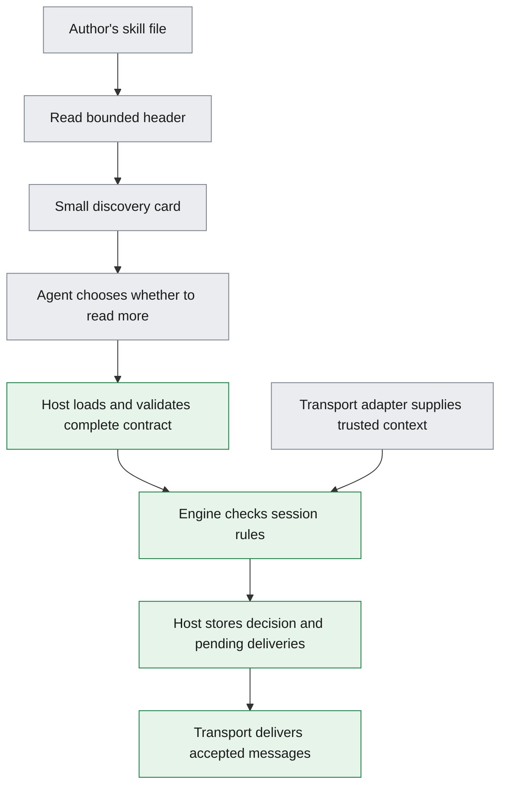

# Multi-agent skills: small headers, bounded sessions, portable engines

This assumes you know software messages, JSON, files, and libraries. Everything else is explained here.

## Summary

A multi-agent skill needs a small discovery header and an execution contract that the host enforces. Contracts are written with YAML frontmatter for engine `0.2.0-lab.1`, and a standard `SKILL.md` package can carry the same fields as metadata. The [header parsers](header-spikes/README.md) pass 47 tests.

The [Elixir contract lab](contract-lab/README.md) implements the local compiler, runtime, documented queries, participant deadlines, room bridge, and journaled program recovery. It has 23 example contracts, and its suite passed 407 tests on 14 October 2026. The [implementation ledger](IMPLEMENTATION.md) records the installed authoring skills and remaining production integrations. The [DSL](spec/contract-dsl.md) and [engine](spec/engine.md) specifications are normative; this report explains the choices behind them.

**Decision:** B, YAML frontmatter in one authoring file. A C wrapper supports standard skill installers. Both load the same contract, so the choice concerns authoring and integration.

## What the pieces mean

A **multi-agent skill** describes how several participants cooperate. A **role** names a participant's responsibility, such as requester or worker. A **contract** specifies permitted messages, their data, and the conditions for sending them.

A **session**, also called an **instance**, is one running use of that contract. Its **state** records the current stage of the conversation. A **transition** moves the session between states. A **state machine** defines the allowed transitions. A **terminal outcome**, such as complete or expired, ends the session.

An **engine** checks messages and updates session state. The **host** is the application that supplies identities, storage, time, and delivery.

A **room** groups participants and messages. One room can contain several sessions and several available skills. A **transport** carries messages, such as a room connection or email. A **transport adapter** converts between that channel and the engine's common message representation.

A **logical message** contains the values the engine needs, independent of the transport's representation. A **transport profile** specifies where the adapter obtains those values. **Authentication** establishes a sender's identity. A **principal** is the identity recognized by the host.

A **discovery card** is a small description used to select a skill. Reading that card does not start a session or authorize an action. Starting a session requires the host to load and validate the complete contract.



This diagram describes the proposed separation of responsibilities. The agent can receive a small card while the host validates a much larger contract.

## What the current prototype already does

The reviewed source is the local room-contract prototype at commit `2821eada3e9707524586e272b7fa65666e5767b2`. I fetched its configured remote before review. The source evidence describes that checkout. It does not establish the behavior of a deployed room service.

| Concern | Verified prototype behavior | Current form |
|---|---|---|
| Small discovery header | The compiler processes the complete source. Existing declarations lack a selection summary and an explicit header boundary. | YAML frontmatter, read within 4,096 bytes before the body. |
| Engine version | A revision declaration identifies the contract revision. The compiler supplies `room-band/1` internally. | A mandatory, exact `engine: 0.2.0-lab.1`; an engine the host does not implement is refused. |
| Mention limits | Rules constrain recipient roles. The runtime also caps accepted messages. | `mentions N` caps the principals each message reaches. There is no session-wide budget. |
| Total expiry | A mandatory lifetime limit already exists. Its target must be a terminal outcome. | The body's mandatory clock, `contract @window => outcome`; `@infinity` opts out. |
| Inactivity expiry | The reviewed room profile has no separate whole-session inactivity timer. | Still none: deadlines sit on owed work, not on silence. |
| Long lifetimes | Durations use seconds, minutes, or hours, with a 30-day maximum. | Durations in `s`, `m`, `h` or `d` up to safe milliseconds, and `@infinity`. |
| Any-state events | Any-state rules and events already exist. | `anystate` and `event` are kept, and `room` adds sessionless events. |
| Room storage | One local SQLite authority owns each instance. SQLite is an embedded database. | Define production room ownership, storage limits, and cleanup. |

These are **source facts**, not new benchmark results. The relevant sources are the compiler (`band-protocols:band_protocols/room_contract.py:571`, historical external source), duration parser (`band-protocols:band_protocols/room_contract.py:174`, historical external source), runtime admission rules (`band-protocols:band_protocols/room_runtime.py:533`, historical external source), and room integration description (`band-protocols:docs/runtime/room-contracts.md:81`, historical external source).

The freeform example also has alternating participant states and a closing message. It does not currently provide a sessionless event model. Freeform source (`band-protocols:band_protocols/protocols/band.freeform-0.1.dsl:1`, historical external source).

## 1. What other skill formats teach us

**Frontmatter** is a metadata block at the beginning of a text file. **YAML** is a structured text format commonly used for that block. The file body can then contain instructions or a contract.

Agent Skills uses YAML frontmatter followed by Markdown. Its required fields are `name` and `description`. Optional `metadata` contains string keys and string values. Instructions and referenced resources load progressively. [Agent Skills specification](https://agentskills.io/specification).

OpenAI's skill documentation describes initial discovery from the name, description, and path. Detailed instructions load when a skill is used. This supports separating selection information from execution instructions. [OpenAI skill documentation](https://learn.chatgpt.com/docs/build-skills).

**Agent2Agent**, abbreviated **A2A**, is a protocol for communication between agents. Its **Agent Card** describes an agent's interfaces, security requirements, and advertised skills. An A2A skill contains descriptive fields such as a name, description, tags, and examples. [A2A specification](https://a2a-protocol.org/v1.0.0/specification/#445-agentskill).

| Existing structure | Useful idea | Limit for this design |
|---|---|---|
| Standard `SKILL.md` | A small description and referenced resources | Instructions do not themselves enforce a conversation. |
| Installed local skills | Short metadata followed by much longer guidance | Their prose is not a typed execution contract. |
| Prototype `.band` contracts | Explicit declarations and message rules | No dedicated discovery summary or bounded header reader. |
| Agent2Agent cards | Discover an agent and its advertised capabilities | A capability description does not define this multi-party state machine. |

The local samples include creative reframing (`~/.agents/skills/creative-reframing/SKILL.md:1`, historical external source), skill creation (`~/.codex/skills/.system/skill-creator/SKILL.md:1`, historical external source), and protocol participation (`band-protocols:skills/protocol-participant/SKILL.md:1`, historical external source). Their common pattern is useful even though their bodies serve different purposes.

The proposed design should distinguish three questions: what cooperation pattern is available, which agents can participate, and which skills a room permits. One description cannot answer all three reliably.

## 2. Two header formats

Both examples use the same summary and roles. The parsers normalize each header, meaning they convert it into the same structure. Each format has a required boundary, so discovery can stop without reading its body. The header carries no clocks or mention caps: those are declarations in the contract body.

### B. YAML frontmatter and a contract body

This puts structured selection metadata above the contract. The closing `---` ends discovery. The body contains the declarative conversation rules, starting with the mandatory contract clock.

```yaml
---
name: room-work
description: Coordinate a requester and a worker to deliver reviewed work. Use when a task needs explicit acceptance and completion.
engine: 0.2.0-lab.1
roles: [requester, worker]
---
```

[Open the complete B example](header-spikes/examples/frontmatter/room-work.md). Its top-level fields belong to this profile; they do not establish compatibility with every standard skill loader.

### C. Standard SKILL.md and a referenced contract

This keeps the standard skill wrapper. The Band-specific values are strings inside `metadata`. Its body tells the reader when to load the separate contract.

```yaml
---
name: room-work
description: Coordinate a requester and a worker to deliver reviewed work. Use when a task needs explicit acceptance and completion.
metadata:
  band-engine: 0.2.0-lab.1
  band-roles: requester, worker
  band-contract: references/work.band
  band-contract-sha256: 3a28fd5a822d3e039697f2e3c38ae2a2c6924444d106c7bbe54f346bf0d87879
---
```

[Open the complete C wrapper](header-spikes/examples/standard/room-work/SKILL.md) and [its referenced contract](header-spikes/examples/standard/room-work/references/work.band).

A **digest** is a fingerprint computed from content. Here, SHA-256 is the digest algorithm. The loader checks the referenced body's digest only when the body is requested. Discovery does not open that file.

### What the tests establish

| Measured result | B: frontmatter | C: standard wrapper |
|---|---:|---:|
| Header bytes read, including delimiters | 204 | 353 |
| Main file bytes | 1978 | 566 |
| Additional referenced file bytes | 0 | 1774 |
| Contract body bytes read during discovery | 0 | 0 |
| Contract body bytes after explicit loading | 1774 | 1774 |
| Normalized discovery card | Equal | Equal |

These counts were **measured** on 15 October 2026 with `mix run scripts/compare.exs`. Bytes are not model tokens, and these results do not measure parser speed or selection accuracy. The contract lab compiles both packages to the same definition digest.

The 47 tests cover the engine field and engine allowlist, exact semantic-version syntax, duplicate declarations, unknown fields, malformed headers, and description length. They also cover large bodies, missing delimiters, YAML restrictions, changed headers, and referenced-file checks. [Test source](header-spikes/test/header_spikes_test.exs).

The reader has a **candidate cap of 4096 bytes**. A header that exceeds the cap fails, including a file with no closing delimiter. Adding a **measured 2 MiB test body** does not increase discovery reads. MiB is a unit of 1,048,576 bytes. This guarantees bounded application reads, not perfect judgments about whether a skill fits a task.

| Choice | Main benefit | Main cost |
|---|---|---|
| B | One source file with familiar structured metadata | A YAML dependency and an explicit supported subset |
| C | A standard skill package with ordinary instructions | More files, string-encoded metadata, and reference consistency checks |

**Decision:** B as the authoring source, with a C wrapper when standard skill installation is useful. The retired native header fails with `frontmatter_required`; any other format is refused (`invalid_format` in the Elixir API, `input` on the portable source envelope).

Both formats generate the same catalog card. That keeps initial agent context independent of authoring syntax. Filter or page large catalogs instead of inserting every description into the agent's context.

The host must validate the complete artifact before activation. A small header cannot establish that the body is valid or truthful. Generated cards also need an artifact identity so stale metadata cannot silently select a different contract.

The parsers validate headers and load bodies; the contract lab compiles and runs them. They do not resolve installed engines. Their loader assumes stable local files. Production loading needs immutable, size-limited packages. [Parser scope and reproduction](header-spikes/README.md).

## 3. Mandatory engine version and compatibility

**Semantic versioning**, or **SemVer**, uses `MAJOR.MINOR.PATCH`. A major change breaks a public contract, a minor change adds compatible features, and a patch repairs compatible behavior. Compatibility depends on defining the public contract clearly. [Semantic Versioning specification](https://semver.org/).

For this engine, the public contract includes syntax, accepted messages, state transitions, timeout ordering, error codes, and generated receipts. The **authority** is the host component allowed to commit a session's decisions. A **receipt** records its decision about a logical message.

| Choice | Author supplies | Consequence |
|---|---|---|
| A | One exact engine semantics version | Simple, reproducible activation and explicit upgrades |
| B | A version range, resolved to one exact version at activation | Easier authoring across compatible releases, with a required lock record |
| C | An exact baseline version plus required feature identifiers | Explicit optional features, with more compatibility combinations |

**Decision:** A. The engine version is mandatory and exact; this profile is `0.2.0-lab.1`. `latest` and any engine the host does not implement are refused, and the compiler reports `engine` at line 1. A future B needs a specified range grammar. SemVer itself does not define package-manager range expressions.

The requested version identifies the engine's specified behavior. A library package can have a separate release number and advertise which behavior versions it implements. A contract digest identifies the exact definition. An author-supplied contract revision can remain optional.

For example, a session records the engine version, contract digest, role assignments, transport profile, and effective limits. Those values remain fixed during the session. Updating a room's default engine must not silently reinterpret active sessions.

The parsers check version syntax and refuse engines the caller does not implement. Production activation must also confirm that an installed engine implements the requested version and passes its compatibility tests. A version string alone is not proof of compatibility.

## 4. Mention caps

A **mention** means a delivered principal, not an `@name` string in text. A message counts its recipients after rosters expand to their bound members, with duplicates removed and the sender excluded. Two roles bound to the same notified identity count once.

One modifier sets the cap. `mentions N` on the `contract` line is the default for every rule; the same option on a rule overrides it for that rule, and `mentions infinity` lifts it. `mention 1` and `mentions 8` are the same option, written with English agreement. With neither set, a rule may reach every principal it names. There is no session-wide mention budget ([mention caps](spec/contract-dsl.md#mention-caps)).

```text
contract @1h mentions 8 => expired
```

The cap is checked three times. The compiler rejects a rule with fixed recipients whose widest delivery exceeds its cap (`mention_limit`). Session creation checks rules that name a roster, once its members are bound. Admission checks each message again.

The host commits the state change, receipt and **outbox** in one **transaction**, so they succeed or fail together. An outbox stores accepted messages awaiting delivery. A retry with the same logical message identity and content returns the prior receipt without another charge. Reusing the identity for different content fails. The host can track transport retry costs separately.

Sessionless room events have no session, so the host sets their quotas per room: `window_ms`, `max_events`, `max_mentions` and `max_receipts`. Optional per-actor shares (`max_events_per_actor`, `max_mentions_per_actor`, `max_receipts_per_actor`) keep one sender from spending the room's whole window. Hosts of shared rooms with untrusted members should set all three ([sessionless room events](spec/engine.md#sessionless-room-events)).

The effective cap can be stricter than the contract's cap when host policy requires it. Activation must expose those effective limits to participants. The host should reject an impossible configuration before starting a session.

## 5. One contract clock and deadlines on owed work

Every contract declares one whole-run clock in its body and puts recovery deadlines on the work participants owe. There is no generic idle timer, because a quiet conversation is not failed work ([recovery defaults](spec/defaults-v2.md)). A **state clock** remains a separate limit for one conversation stage.

| Declaration | Meaning |
|---|---|
| `contract @30m => expired` | Fixed cap, measured from session creation |
| `contract @80m max @4h => expired` | Renewable window under a fixed ceiling |
| `contract @infinity => expired` | Explicit opt-out: no whole-run clock |
| `state reviewing @5m => stalled` | Caps one entry into a state |
| `\| @5m & stalled` under `lead -> reviewer: request() awaits reviewing` | The reviewer owes one reply within five minutes of the request ([reply alternatives](spec/contract-dsl.md#reply-alternatives)) |

### The clock is mandatory

A source without a `contract @window … => outcome` line fails with `contract_clock_required`. A bare `contract` line that only carries documentation does not count, and the header cannot supply a clock. Authors choose the window deliberately, and `@infinity` is the explicit way to have no whole-run limit. A template can suggest a window, but it writes the chosen one into the artifact. A host may enforce stricter admission limits, but it must expose the effective values.

### Durations

Durations are positive integers in `s`, `m`, `h` or `d`, where a day is exactly 86,400 seconds, and must fit safe milliseconds. `@infinity` disables only the whole-run clock; state clocks and deadlines on owed work are always finite. `90d` does not equal every three-calendar-month interval. A host can refuse `@infinity` under its deployment policy, and an accepted session without a whole-run clock still needs cancellation, capacity limits, and storage rules.

### Deadlines on owed work

A request that waits for its answer lists the replies it accepts, each with its next state, and closes with a timeout: `lead -> reviewer: request() awaits reviewing`, then `=> review() & collected` and `| @5m & stalled`. The recipient owes one reply within five minutes of the request. A request answered by a separate rule in its target state is refused with `reply_required`. A timed rule makes a message owed when its state is entered; it is for an owed report that answers no request. With `each` or a single sender, every selected sender owes it; a group without `each` needs one. A timed event, such as `event worker -> lead: ack() @5m => stalled`, is owed once per state entry without moving the state. A progress event extends a deadline only when its rule declares a [renewal](spec/renewable-timeouts.md) of `@self`, `@state` or `@contract`.

The authority uses its acceptance time, not a sender-supplied timestamp. An email sent earlier can count when accepted, but it cannot revive an already expired session.

### Deadline ordering

Due timers run before a message is admitted, so a message at the exact deadline is late. At equal times the order is a work duty, a collection deadline, an offline grace, a state timeout, a host trigger, then the whole-run cap ([timeout scopes](spec/timeouts-v2.md)). A timer fires at its scheduled time, and the remaining due timers then run again in that order.

For illustration, take a 12-hour contract clock and a review owed within four hours of entering `reviewing`. This is a **modeled example**, calculated directly from those durations.

| Time | Occurrence | Contract deadline | Review deadline |
|---|---|---|---|
| 09:00 | Session created | 21:00 | None yet |
| 11:00 | Submission accepted; `reviewing` entered | 21:00 | 15:00 |
| 14:00 | Duplicate retry received | 21:00 | 15:00 |
| 15:00 | No review accepted | 21:00 | Session ends `stalled` |

A review arriving at 15:00 is too late, and the duplicate retry changes nothing.

The host must persist deadlines and recheck them during admission, restoration, and state reads. Restoring a session does not grant a fresh response window. Durable timers request closure without waiting for a new message. A stale timer callback must recheck the current stored deadline before closing the session.

An unavailable host cannot physically send a timeout notification on schedule. On recovery, it must recognize expiry before accepting new work. Logical expiry and notification delivery remain separate.

### Implementation

The contract lab implements the mandatory clock, renewal, state clocks, duties and the equal-time order, which the `V2-TIE-ORDER` requirement checks. Closing a session does not prove that an external operation stopped. A payment or remote job can remain uncertain after a deadline. The host must retain the records needed to settle that uncertainty. Existing external-effect limitations (`band-protocols:docs/runtime/room-contracts.md:117`, historical external source).

## 6. Room memory and cleanup

The room needs different retention rules for active state, historical content, and unresolved work. **Retention** means how long the host keeps a category of data. A small **tombstone** records that a session identity is closed, even after its full history is removed.

| Choice | Storage policy | Consequence |
|---|---|---|
| A | Retain complete session histories indefinitely | Simple recovery, but growing storage |
| B | Keep active state, archive selected content, retain small closure records | Practical cleanup with explicit replay rules |
| C | Delete terminal sessions immediately | Small storage, but delayed retries can lose their original meaning |

**Recommendation:** B. A **replay window** is the period during which the host can still consider an old message for acceptance. Keep the following categories separate.

| Data | Purpose | Cleanup condition |
|---|---|---|
| Active session state | Admit legal messages and enforce limits | Session reaches a terminal outcome |
| Payloads and detailed history | Human review and optional audit | Configured retention period ends |
| Closed identities and receipts | Reject reuse and recognize retries | The protocol's replay window has safely ended |
| Unresolved external-operation records | Prevent false claims about completion | Outcome is settled or an explicit external retention policy applies |

An email transport can deliver messages very late. Cleanup therefore needs bounded request validity, permanent non-reuse of session identities, or another explicit identity-expiry mechanism.

Deleting a receipt must not turn an unknown outcome into proof that nothing happened. An old request must not recreate a deleted session automatically. Retention tests need delayed delivery and restart cases.

Expiry bounds how long a finite session remains active. It does not bound the total number of sessions a room can create. Add limits for active sessions, creation rate, stored bytes, and retained unresolved operations.

There is no finite-storage guarantee if infinite sessions and unresolved records can accumulate without limits. When capacity is exhausted, the host must reject new work or apply an explicit archival policy.

The current prototype uses local instance databases and retains accepted evidence. Production cleanup and safe owner transfer remain separate design work. Current ownership boundary (`band-protocols:docs/runtime/room-contracts.md:128`, historical external source), implementation ledger (`band-protocols:docs/runtime/room-contracts-implementation-ledger.md:1`, historical external source).

## 7. Both event scopes

An **event** communicates information without advancing the conversation state. The agreed design needs both sessionless room events and events valid in every active session state.

An **envelope** is the metadata around the message data. **CloudEvents** is a standard event-description format. Its transport bindings distinguish envelope attributes from event data. [CloudEvents HTTP binding](https://github.com/cloudevents/spec/blob/v1.0.2/cloudevents/bindings/http-protocol-binding.md).

| Choice | Representation | Tradeoff |
|---|---|---|
| A | One event envelope with an explicit scope | Compact, but validation must enforce conditional fields |
| B | Separate room-event and session-event envelopes | Clear scope and required-field rules |
| C | A standard CloudEvents envelope with defined scope extensions | Useful ecosystem tooling, with extra mapping work |

**Recommendation:** B for the engine's logical types. A transport can encode them through C when useful.

```json
{"type":"room.event","id":"notice-42","kind":"availability","payload":{"status":"ready"}}
```

```json
{"type":"session.event","session_id":"work-17","id":"progress-5","kind":"progress","payload":{"note":"Draft ready"}}
```

These are proposed envelope fragments. The adapter still supplies room identity, sender identity, and other required context. The first event has no session. The second requires an active session and an allowed sender.

An any-state event must not reopen a terminal session or extend the contract clock. It satisfies a completion obligation only when the contract says so: a timed event discharges its own duty, and only a declared renewal extends a deadline. [Engine timers](spec/engine.md#timers).

Sessionless does not mean storage-free. Authentication, membership checks, recipient limits, rate limits, and duplicate suppression still apply. A room event must not become an alternate route for claiming a session completed.

## 8. A master specification that generates libraries

A **normative specification** states the rules implementations must obey. A **conformance test** checks an implementation against those rules. A **test vector** supplies exact inputs and expected outputs.

The master specification needs executable structure as well as explanations. A **schema** describes permitted data fields and their types. Field descriptions alone cannot generate timeout ordering or state transitions. Protocol Buffers illustrates generation of data classes, parsers, and serializers from a schema. [Protocol Buffers overview](https://protobuf.dev/overview/).

| Choice | What the specification generates | Tradeoff |
|---|---|---|
| A | Data types, validators, and test fixtures | Useful, but workflow semantics remain handwritten |
| B | Those artifacts plus a constrained semantic core | Meets the goal of generating reusable engine behavior |
| C | Client bindings to one shared engine service | Fewer semantic implementations, but a shared runtime dependency |

**Recommendation:** B. Define a constrained rule model that generates the pure engine core. Keep transport, authentication, clocks, and persistence behind small host interfaces. Do not add arbitrary executable expressions to contracts.

A **pure core** computes a result from explicit inputs without reading external state or performing delivery. Its interface can use this form:

```text
step(contract, session_state, logical_message, trusted_context)
  -> decision, next_state, receipts, delivery_intents
```

A **delivery intent** describes an accepted message that the host should send. The host commits state, quotas, receipts, and delivery intents together. Sending occurs from the durable outbox after that commit.

The source package should contain the grammar, typed rule model, state-transition rules, error catalog, time rules, and transport-profile definitions. Generated artifacts should include parsers, core libraries, data types, fixtures, reference documentation, and compatibility manifests.

The specification governs disagreements. The first library and its tests provide the initial integration target. They must not silently redefine the specification through accidental behavior.

### Fixed implementation order

| Stage | Deliverable | Compatibility gate |
|---|---|---|
| Elixir first | Specification model, generator, native library, reference runner, and host interfaces | Independent expected-result vectors pass |
| Python second | Generated native core and Python host interfaces | Same vectors and trace comparisons against Elixir |
| TypeScript third | Generated native core and typed interfaces | Same results, with explicit number and missing-value handling |
| Rust fourth | Generated native core and typed interfaces | Same results, with checked integer and time behavior |

A **trace** is a sequence of inputs and resulting decisions. **Differential testing** feeds the same trace to multiple implementations and compares results. Include independently authored expected results, because a shared generator can reproduce the same mistake everywhere.

The compatibility suite must cover the contract clock and every deadline boundary, equal-time ordering, stale timer callbacks, time rollback, and restart recovery. Include malformed input, duplicate identities, conflicting retries, quota exhaustion, child activity, and role replacement. It must also distinguish missing fields from `null`, reject duplicate JSON keys, and specify integer bounds and text encoding.

**Canonicalization** means converting equivalent data to one precisely defined byte representation. This matters for digests and signatures. The JSON Canonicalization Scheme provides one specified approach. Adopting it would require explicit compatibility work with the current sorted-key encoding. [JSON Canonicalization Scheme](https://www.rfc-editor.org/rfc/rfc8785.html), current encoding (`band-protocols:band_protocols/room_runtime.py:25`, historical external source).

One existing rule needs an explicit decision in the new specification: rejecting a proposal can still persist an overdue timeout. The current room runtime does this deliberately. Define clock advancement separately from proposal acceptance so every language returns the same result. Admission ordering (`band-protocols:band_protocols/room_runtime.py:573`, historical external source).

The implemented Elixir lab now includes the pure runtime and a reference scenario runner alongside discovery. A specification generator and generated production libraries remain proposed work. The later languages have not been implemented for this new profile.

## 9. Transport-owned fields and operation over email

A transport profile reconstructs one logical message from the available channel information. Some values can come from authenticated connections, others from headers or message data.

| Choice | Wire representation | Tradeoff |
|---|---|---|
| A | Put all non-secret message context in every JSON envelope | Easy inspection, with repeated information |
| B | Configure each field's source and reconstruct one logical message | Avoids duplication while preserving explicit semantics |
| C | Supply predefined profiles for each transport | Simpler deployment, with less flexibility |

**Recommendation:** B, with C profiles shipped as tested configurations. Keep A as a useful portable debugging profile. CloudEvents provides a relevant precedent: HTTP headers can carry attributes while the body carries event data. [CloudEvents mapping](https://github.com/cloudevents/spec/blob/v1.0.2/cloudevents/bindings/http-protocol-binding.md#3-http-message-mapping).

An illustrative room profile could declare:

```yaml
profile: example/room-bound
fields:
  actor: authenticated_connection.principal
  room_id: authenticated_route.room_id
  session_id: bound_channel.session_id
  engine: bound_session.engine
  contract_digest: bound_session.contract_digest
  message_id: body.id
  kind: body.kind
  payload: body.payload
duplicate_fields: reject
```

The corresponding body can stay small:

```json
{"id":"offer-42","kind":"offer","payload":{"task":"Draft a release note"}}
```

The adopted form is the versioned [`band-contract/carrier/1`](spec/transport.md#carrier-map-profile) map, which belongs to the transport binding rather than the contract. Omission is valid only when the adapter can supply the required value unambiguously. A room identifier does not identify a session when several sessions share that room. An authenticated connection identifies a principal only under the host's authentication policy.

The profile must distinguish trusted context from sender-controlled claims. Moving `actor` from JSON into an arbitrary header does not authenticate it. Conflicting duplicate fields should fail rather than select whichever value was read first.

For email, the adapter can use verified application-level identity and explicit session metadata. A visible `From` address alone is insufficient. An email thread identifier also need not identify one contract session.

```text
Transport: email
Verified sender principal: supplied by the configured email adapter
Room identifier: resolved from an approved mailbox binding
Session identifier: explicit application metadata when the binding is ambiguous
Logical message identifier: preserved across transport retries and bridges
Body: kind and payload, plus any fields the adapter cannot supply
```

A **bridge** forwards a logical message between transports. Provider-specific message identifiers can change during forwarding, so they must not silently replace the logical message identity. The bridge must preserve the values used for duplicate detection and signatures.

Transport independence means the engine does not depend on a particular delivery channel. It does not mean every channel supplies the same identity, privacy, ordering, or delivery guarantees. The host must reject a profile that cannot meet a contract's required capabilities.

## 10. A2A, room discovery, and DNS

Discovery should connect a skill definition to agents and room policy without making those objects interchangeable. A room attachment records which skill the room permits and how roles can be assigned.

| Object | Question answered | Proposed contents |
|---|---|---|
| Multi-agent skill card | What cooperation pattern can I choose? | Summary, roles, engine version, limits, artifact location and identity |
| Agent Card | Which agent can I contact and what does it advertise? | A2A interfaces, capabilities, security requirements, and advertised skills |
| Room attachment | Which skills may run here? | Approved artifact, role bindings, host limits, and activation policy |

A2A defines discovery through a well-known address, registries or catalogs, and direct configuration. A **well-known address** is a standardized location under a server's domain. Its Agent Card uses `/.well-known/agent-card.json`. [A2A discovery](https://a2a-protocol.org/v1.0.0/specification/#82-discovery-mechanisms).

A2A separates the agent's own `version` from each interface's `protocolVersion`. Our required contract-engine version is another value. An adapter must preserve this distinction. [A2A card and interface fields](https://a2a-protocol.org/v1.0.0/specification/#441-agentcard).

**DNS** is the Domain Name System. **DNS-SD** uses DNS records to discover services. Pointer records enumerate services, service records identify hosts and ports, and text records carry small attributes. [DNS-based Service Discovery](https://www.rfc-editor.org/rfc/rfc6763.html).

| Choice | Discovery route | Appropriate use |
|---|---|---|
| A | Configured catalog and well-known Agent Cards | Initial implementation with explicit trust relationships |
| B | Curated registry with searchable skills and engine compatibility | Larger organizations and cross-team discovery |
| C | DNS-SD hints followed by verified Agent Card retrieval | Optional discovery on a local network |

**Recommendation:** A first, with B as an additional index. Treat C as an optional adapter. Store a pointer and small hints in DNS, not the complete multi-agent contract.

There is already an A2A-specific DNS-SD Internet-Draft, published August 19, 2026. It proposes `_a2a._tcp` discovery and treats results as untrusted hints. It is **work in progress, not an adopted standard**. [A2A DNS-SD draft](https://www.ietf.org/archive/id/draft-zhao-a2a-dns-sd-00.html).

A proposed Band extension could associate an advertised agent skill with a contract location, digest, supported roles, and engine versions. This association would be our extension, not a guarantee supplied by A2A itself.

Discovering an endpoint does not authorize work or establish its identity. The host must verify the peer and apply room policy before activation. Signed metadata still needs a trusted signer and freshness policy.

## 11. Outcome dependencies and bounded rounds

PR #4 in the private band-protocols repository proposes `DONE`, typed operation references, evidence checked by the receiver, and bounded state entries called `ROUNDS`. The investigation and executable probes (`investigations/pr-4/README.md`, historical artifact) review its exact head and compare it with the room prototype.

**Recommendation for discussion:** use explicit named outcome dependencies and committed result evidence, and investigate bounded state entries as an additional limit. A build can require a review's `approved` outcome. Rework can require a check's `failed` outcome. A universal success flag is optional. The PR's named outcome references work without `DONE`, as a local control test confirmed.

The room prototype already checks an exact attachment, instance, contract definition digest, and published terminal outcome before dependent activation. Both its successful and cancelled producer cases passed again. Contract-level dependency declarations and portable verification across authorities remain design work.

Evidence must establish that the producer's session accepted the result. Four new acceptance probes reproduced three gaps in the PR. A foreign protocol can satisfy a gate on either side. A rejected closing message can count as completion. Replay can accept a build that live evidence verification rejected.

The PR's existing 266 tests pass. These additional probes fail against the unchanged head. Its lint failure also occurs on its base. The investigation retains the exact commands and results.

`ROUNDS` bounds entries into a state, including self-transitions. It complements the contract clock and the deadlines on owed work. Its counter survives resurrection of the same session. A room implementation still needs an explicit scope for counters across new or replacement children.

The PR's operation-gate syntax remains an investigated proposal. The later Elixir lab implements explicit terminal outcomes, correlated accepted-message references, and `max_entries` bounds. Cross-session producer gates are not part of that local implementation.

## 12. A lightweight room for tests

The [Elixir room simulator](room-sim/README.md) is implemented as a small in-memory process with no external dependencies. It models participant identities, direct mentions, reference-only mentions, different agent and user visibility, and separate stored messages and notifications. Its behavior is grounded in the Band platform source as fetched on October 10, 2026.

Tests can advance virtual time and explicitly delay, duplicate, drop, reorder, or replay notifications. Replayed notifications keep their message IDs. A scripted lead/reviewer/builder exchange demonstrates recovery from a lost notification. **25 tests pass** after an observed initial failure. Two mutation checks also demonstrate that the visibility and due-time guards are tested.

The simulator supplies transport and time to the engine under test. It does not interpret a post as a valid transition, manufacture accepted outcomes, or execute contract clocks and deadlines. The real engine must retain those responsibilities. `fetch` is a visibility-checked testing convenience, not a claim that Band has the corresponding endpoint.

This supports quick iteration without starting Band's database or services. Production authentication, persistence, presence, listener races, and complete API compatibility still require separate integration checks. The simulator's guide documents the deliberate differences, including its stricter removal behavior.

## Decisions

The table separates local implementation and decisions already taken from remaining design recommendations.

| Topic | Current disposition | Choice |
|---|---|---|
| Header | Frontmatter (B) and standard-wrapper (C) parsers implemented and tested. | Decided: B, with a C wrapper |
| Engine version | Mandatory and exact. The local compiler implements `0.2.0-lab.1` only. | Decided: exact SemVer behavior version |
| Mentions | `mentions N` caps each message's delivered principals; no session-wide budget. Room events have separate host quotas with optional per-actor shares. | Decided: contract-line default, rule override |
| Clocks and deadlines | Mandatory contract clock (`@infinity` opts out), state clocks, duties and renewal implemented. No idle timer. | Decided: deadlines on owed work, not on silence |
| Room storage | Source reviewed and retention tradeoffs documented. Production implementation pending. | Active state, archives, and closure records |
| Events | Any-state and sessionless events implemented and tested locally. | Separate logical event types |
| Specification and libraries | Architecture and compatibility artifacts proposed. | Generated semantic core, Elixir → Python → TypeScript → Rust |
| Transport fields | Strict `id`/`session` normalization and a room-simulator bridge implemented. Production and email adapters remain separate work. | Explicit field-source profiles |
| Discovery | Agent Skills, A2A, and DNS sources reviewed. Integration pending. | Catalog and verified cards first |
| Outcome dependencies and bounded rounds | PR #4 investigated. Three implementation gaps reproduced. Local outcomes, correlated facts and bounded entries implemented. Cross-session gates remain proposed. | Named outcomes, committed result evidence, and explicit counter scope |
| Development room simulator | Dependency-free Elixir helper implemented. 25 tests pass, with a working conversation example. | Use as the fast transport/time test layer. Keep contract enforcement in the engine. |
| Contract creation and iteration | Master and sub-skills installed. Documented history-derived contracts and asserted scenarios pass. | Preserve evidence, explicit choices and pinned session identities |
| Deterministic replacement | Program supervision, journal/snapshot recovery, code generation adapter and room demonstration pass locally. | Connect a live provider and production host separately |
| Report | Explainer v3, updated on 14 October 2026 to the current profile. | Current |

All artifacts are local. No production changes, merges, deployments, or external publication are part of this delivery.

## Glossary

| Term | Meaning |
|---|---|
| API | Application programming interface: callable operations exposed by a library or service. |
| Authority | The component allowed to commit a session's decisions. |
| Canonicalization | One precisely specified byte representation for equivalent data. |
| Conformance | Agreement with the specification's required behavior. |
| Contract clock | The mandatory whole-run limit, `contract @window => outcome`, measured from session creation. |
| Digest | A fingerprint computed from content. |
| Discovery card | A small description used to select a skill. |
| Duty | A message a participant owes within a deadline after entering a state. |
| Frontmatter | A metadata block at the beginning of a file. |
| Host | The application providing identity, storage, time, and delivery. |
| HTTP | Hypertext Transfer Protocol, a common web transport. |
| Outbox | Durable pending deliveries stored with an accepted decision. |
| Receipt | The stored decision for a logical message. |
| README | A guide file that explains a package and how to use it. |
| Replay window | The period during which an old message can still be considered. |
| SD | Service Discovery, the discovery part of DNS-SD. |
| SemVer | Semantic versioning using major, minor, and patch components. |
| SHA-256 | The content-digest algorithm used in the reference-file example. |
| Tombstone | A small record that an identity is closed or retired. |
| UTF-8 | The text encoding used for the byte measurements. |
| YAML | A structured text format used for metadata. |

## Evidence and reproduction

The [parser reproduction guide](header-spikes/README.md) gives scope, commands, dependency versions, and limitations. The research manifest (`evidence/research-sources.json`, historical artifact) identifies reviewed sources. The expectation ledger (`journal.json`, historical artifact) tracks each requested item.

The experimental repository has no configured remote. The researched prototype remains unchanged at the cited commit.
