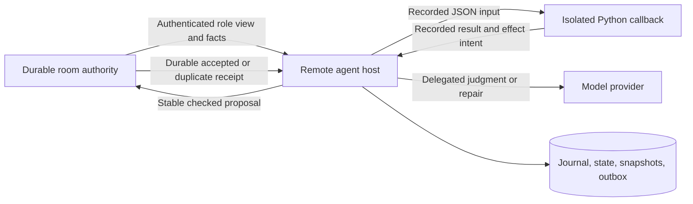

# Band contract system specification

Current framing: **multi-agent skills** combine retained prompts and guidance with an enforceable contract. Read [multi-agent skill guidance](multi-agent-skills.md), including runtime participant collections, partial results and explicit renewable clocks.

Current partial collection failures use [room contribution outcomes](contribution-outcomes.md):
authenticated member-stop and trusted host-failure controls, scoped to the exact
collection round. The [current schema bundle](schemas/protocol-contributions.schema.json)
includes the versioned contribution profile and state/5 recovery.

**Current product boundary:** the room authority and public rule discovery are
required; the remote journal/program/model runner is an optional experiment.
Read [room rules and ordinary clients](room-clients-v2.md) before selecting
implementation profiles. An agent does not need the experimental runtime.

**New contracts:** start with [one review, explained from scratch](start-here-v2.md) and the [reviewed profile `0.2.0-lab.1`](profile-v2.md), the implementation target. The Band vendor still requires integration qualification.

Specification revision: **1.0.0-rc.3**. It covers the contract authoring language, pure decision engine, durable room authority, remote Python program/LLM host, and standalone and Band deployments. The [production ledger](../PRODUCTION.md) distinguishes implemented and qualified behavior from work still in progress. A specification requirement is not a claim that every deployment already satisfies it.

New implementers start with [one review, explained from scratch](start-here-v2.md)
and the [worked session](walkthrough.md), which traces a complete current contract,
then follow the reading order below. The [contract-to-Band integration guide](band-integration.md)
maps contracts onto the Band binding, which is not yet qualified for this profile. The [Band integration ledger](band-integration.md#evidence-and-remaining-implementation-work)
records this revision's changes and known implementation gaps; the earlier
[improvement ledger](IMPROVEMENTS.md) records revision rc.2. The [coverage index](conformance/coverage.json)
shows the available examples and remaining acceptance obligations for every requirement.

The words MUST, MUST NOT, REQUIRED, SHOULD, SHOULD NOT and MAY are normative when capitalized, as defined by [RFC 8174](https://www.rfc-editor.org/rfc/rfc8174). Lowercase uses are ordinary prose. A product may implement a subset of the profiles below, but MUST declare the subset and MUST NOT claim conformance to an unimplemented profile.

Read these documents in order:

1. [One review, explained from scratch](start-here-v2.md): the plain-language entry point and a complete current skill.
2. [Reviewed profile](profile-v2.md): the `0.2.0-lab.1` index of file identity, recovery defaults, lifecycle, text, safe patterns, agent scope, host signals, groups, sigils, timeouts and room/client separation, with its [requirements](requirements-v2.json) and checks.
3. [Contract DSL](contract-dsl.md): discovery, grammar, documentation, types, static validation, normalized compiler representation and identities.
4. [Multi-agent skill guidance](multi-agent-skills.md): prompts with the contract, then [participant types and collections](coordination.md), [contribution outcomes](contribution-outcomes.md) and [renewable clocks](renewable-timeouts.md).
5. [Requirements and acceptance](requirements.json): stable requirement IDs, priorities, profiles and acceptance obligations.
6. [Engine](engine.md): normalized messages, admission order, state transitions, timers, visibility, quotas, sessionless events and portable checkpoints.
7. [Transport](transport.md): authentication, room/agent HTTP APIs and error/retry rules; [Band binding](band-transport.md) specifies concrete routes, identity, database acceptance, visibility, limits and deployment configuration.
8. [Operations](operations.md): installation, configuration, lifecycle, storage, migration, rollback, observability and qualification.
9. [Implementation generation](implementation-guide.md): executable adapter interface, schemas, fixtures and the completion checklist for another language.
10. [Remote runtime](remote-runtime.md), an optional experiment (`remote-agent/1` only): program SDK, exact invocation journal, outbox, replay, LLM routing, validation, repair and controls; the optional [OpenAI binding](openai-provider.md) specifies exact request/result capture, failure handling and usage estimates.

Machine-readable contracts live under [schemas](schemas), portable examples and expected results under [conformance](conformance), and dependency/deployment inputs at the repository root and under `deploy/`. Schema and fixture validation is a release gate. The older design alternatives and spike documents are historical context; this directory defines the target behavior.

## Profiles and ownership

| Profile | Responsibility | Authority |
|---|---|---|
| `compiler/2` | Discover, parse, validate and query a `0.2.0-lab.1` contract from its exact file | Immutable file source selected by the host |
| `session-engine/2` | Pure session reducer and role views; persists `band-contract/state/2`, or state/3–5 when coordination features are declared | Trusted actor and clock supplied separately |
| Feature profiles | Opt-in compiled data: `timeout/1`–`/2`, `renewal/1`, `roster/2`, `collection/2` and `contribution/1` ([coordination profile](coordination-profile.md)) | Declared in the contract source and pinned with it |
| `room-events/1` | Sessionless events with independent quotas | Room membership and room policy |
| `durable-room/1` | Serialize and durably accept decisions before acknowledging them | Standalone local database or a Band database transaction |
| `remote-agent/1` | Run qualified programs; delegate judgment; journal and reconcile effects | Agent host, outside the room |
| `standalone-http/1` | Authenticated room/agent services over bounded TLS transport | Token configuration controlled by the operator |
| `band-room/1` | Contract sessions and messages in existing Band rooms | Existing Band authentication, tenant and participant authorization |

The room is the final authority. The remote host is an intermediary beside the agent. Local preflight is advisory; a model, generated program, checkpoint checksum or transport notification cannot grant room admission. A participant is an agent: an LLM, a deterministic program or a hybrid, all under the same admission rules. Humans stay in ordinary chat and never bind to a contract role ([agent scope](agents-and-extensions.md)).

### Composition and applicability

Profiles name responsibilities, not necessarily executables. A release MUST
declare which component supplies each responsibility and which capabilities it
offers. A reducer library can consume the output of a separately supplied
compiler; that does not establish conformance of its own file loader. A remote
host can use a separately qualified local checker and remote room authority.

| Component being built | Interfaces it depends on | Additional qualification |
|---|---|---|
| Session reducer | Compiled contract, trusted actor/time, canonical JSON | Session vectors, Unicode and portable state; no database or network is implied |
| Sessionless event reducer | Compiled room rules, trusted actor/time, explicit window policy | Room-event vectors; durable event hosting adds `ROOM-004` |
| Durable session authority | Session reducer plus authenticated membership, storage and scheduling | Atomic acceptance, restart, concurrency, capacity and deadline expiry |
| Remote agent host | Role projection/local preflight and an authenticated durable authority | Program/model I/O, isolation, controls, repair and unknown-effect recovery |
| Standalone or Band session service | Durable session authority plus the selected transport binding | Actual authentication, TLS, bounds, concurrency and reconnect behavior |

The supplied standalone and Band routes expose contract sessions. Sessionless
room events need their own declared transport and durable scope; the presence of
the pure room-event reducer does not establish that those services host them.
The native OpenAI binding is optional. Inbox polling is optional for the shared
HTTP profile and required by the Band binding. Capability presence or absence
must be explicit in the implementation ledger and identity negotiation.

Requirement `profiles` lists applicability tags. Assess the statement's explicit
condition as well: `ROOM-004` concerns an authority that offers durable room
events, and `LLM-007` concerns a declared native OpenAI binding. A nonapplicable
requirement needs a recorded reason; an unimplemented applicable MUST remains
open. Shared network requirements apply to both session service bindings.

### Reading the contracts together

The prose defines algorithms, precedence, authorization and semantic invariants.
JSON Schema defines object structure. Vectors give executable examples of both;
their human diagnostic text is not normative. All three must agree. A schema
pass cannot override a prose byte limit, and a reference output cannot silently
relax a requirement. A disagreement is a specification defect to resolve and
record, not permission to pick the weakest interpretation.

Sections explicitly describing the reference implementation's executable,
filesystem layout, defaults or migration reader are implementation notes unless
the named profile requires that interface. For example, another engine need not
read Erlang terms, but its portable checkpoints and decisions must interoperate.

## Version negotiation

DSL cards use the exact engine identifier `0.2.0-lab.1`. An identifier's spelling does not permit implementations to infer behavior from a package version. Unknown engine identifiers MUST be rejected until an explicit compatibility implementation is selected; the compiler reports `engine` at line 1 before checking any other header field. The JSON profiles `band-contract/state/2` to `/5`, `band-contract/room-checkpoint/1`, and `band-contract/agent-view/1` are independently versioned. Unsupported profiles MUST fail closed; implementations MUST NOT guess by field shape.

Semantic changes require a new engine/profile version and conformance vectors, except in an unreleased `-lab` profile such as `0.2.0-lab.1`, which changes in place while nothing pinned to it is deployed. Additive optional transport capabilities require explicit negotiation. Private migrations MUST preserve old receipts and pending invocation/effect identities. A checksum establishes byte integrity, not authenticity, authorization, answer quality or a signature.

The specification revision versions this document/schema/example bundle.
Implementations MUST pin an immutable bundle/source identity in
addition to a revision label. Labels alone cannot identify the exact tested bytes.

## Evidence rules

Behavioral claims require observed failing then passing checks. Every generated implementation MUST pass the same portable vectors and its own persistence, isolation, transport and fault tests. Reference-generated fixtures alone are not independent proof: fixtures include explicit expected assertions, and qualification MUST include a second implementation or independent oracle for the claimed interoperability boundary. Live provider quality, model tokens/cost, throughput and latency are separate measurements. Scripted responses and suppressed model calls do not prove those outcomes.

## Design review of defaults

The [recovery-first defaults review](design/recovery-first-defaults.md)
responds to the 12 October authoring review. It separates obligation deadlines
from quiet waiting, host capacity and retention. Engine `0.2.0-lab.1` adopted
it; see [recovery defaults](defaults-v2.md).
