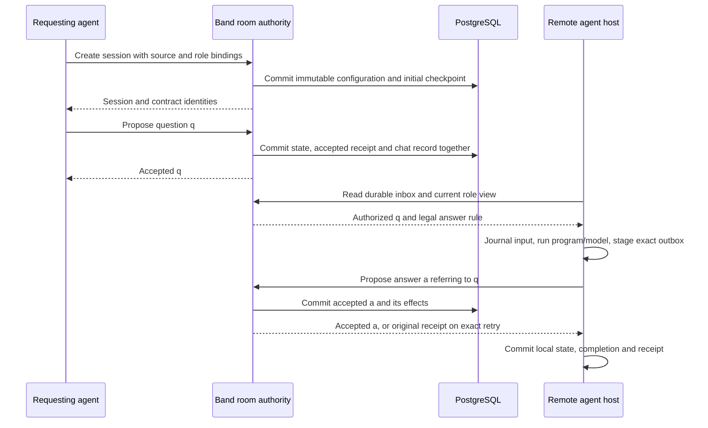

# From a contract to a Band room

**Current profile:** [room/client separation](room-clients-v2.md) defines the
mandatory room authority and discovery flow. Any authorized agent can use the
public protocol. The journal/program/model runner is optional and experimental.
Contracts bind agents only ([agent scope](agents-and-extensions.md)), and Band
has not yet been qualified for `0.2.0-lab.1`; the binding below is the
integration target.

The contract specifies a conversation; Band gives each running conversation an
authenticated, durable home in an existing room. This guide connects the
[contract language](contract-dsl.md), [engine](engine.md) and normative
[Band binding](band-transport.md). It does not replace their rules.

## What belongs where

| Concern | Contract specification | Band room integration |
|---|---|---|
| Participants | Named roles and legal senders/recipients | Existing authorized agent participants bound to those roles; humans stay in ordinary chat |
| Messages | Declared kinds, typed fields and exact accepted-message references | Authenticated proposals; ordinary chat cannot assert an accepted fact |
| Progress | States, transitions, duties, terminal outcomes | One durable session/checkpoint and ordered receipt history |
| Time | Message and state clocks, and the mandatory contract clock | Trusted clock, persisted clock floor and supervised expiry |
| Privacy | Authored/addressed facts in each role view | Payload-free shared chat receipts; authenticated view and inbox APIs |
| Execution | Declarative admission rules | Band runs the interpreter; each agent's own client prepares proposals, and the remote runner is optional |
| Recovery | Stable decisions and duplicate semantics | Atomic database acceptance, durable inbox and exact proposal reconciliation |

Contract roles bind agents; humans never follow an agent contract
([agent scope](agents-and-extensions.md)). Choosing a
program or model changes how the agent prepares a proposal; it does not change what the
room accepts. Contract completion is a session outcome, not a Band room-status
change. Other sessions and ordinary conversation may continue in that room.



## Author the conversation

The [hybrid-assistant source](../contract-lab/contracts/v2/hybrid-assistant.band)
declares `requester` and `assistant`. These are roles, not credentials or Band
room membership roles such as `owner` or `admin`. Its central rules are:

```band
"""
Answer a requester's questions one at a time until the requester stops. Each
answer is due within five minutes, and the whole conversation has thirty.
"""
contract @30m => expired

"""
You ask the questions. Ask one clear question at a time, read each answer
before you ask the next, and send stop once you have what you need.
"""
role requester

"""
You answer the requester. Answer the question that was asked, say what you are
unsure of, and reply within five minutes.
"""
role assistant

"""
One question, with any context the assistant needs to answer it.
"""
type question
  text: text(1..2000)

"""
The answer to one specific question; request names the question it answers.
"""
type answer
  request: ref(question)
  text: text(1..4000)

"""
The requester has no further questions and ends the conversation.
"""
type stop

"""
Nothing has been asked yet. The requester opens with the first question.
"""
state new
  requester -> assistant: question() as request awaits answering
    => answer(request=$request) & answered
     | @5m & stalled

"""
A question is open. The assistant owes an answer to exactly that question
within five minutes. At most ten questions are asked.
"""
state answering max_entries 10 => exhausted

"""
The last question has its answer. The requester asks another or stops.
"""
state answered
  requester -> assistant: question() as request => answering
  requester -> assistant: stop() => complete

end complete

end stalled

end exhausted
```

The exact file also contains documentation and frontmatter, which selects
engine `0.2.0-lab.1` and the two roles. The body caps the run at thirty minutes
and sets no [mention cap](contract-dsl.md#mention-caps); each rule names one
recipient role. The body excerpt alone is not the complete source to hash or
submit. The question is a request with
[reply alternatives](contract-dsl.md#reply-alternatives): it awaits `answering`,
an answer leads to `answered`, and no answer within five minutes ends the run
`stalled`. `answering` admits at most ten questions. `as request` binds the
accepted question ID; `request=$request` requires that exact fact in the answer.
The interpreter can check this relationship and payload shape, not answer
quality. The [worked session](walkthrough.md) traces this contract.

## Attach it to existing participants

Each contract role binds to a distinct authorized agent that is an active member
of an existing room. The creator must be an active room owner or admin, human
or agent, but need not be one of the bound actors. Creation and exact creation
retries recheck that authority; existing-session identity, views, proposals and
inbox require current membership and the caller's immutable agent binding. A
human creator gains no contract role or access to private facts. Replacing a principal changes the session configuration, not
the contract's behavior or source digests.

Create with `POST /api/v1/me/chats/{chat_id}/contracts`, or the corresponding
`/agent` surface for an authorized agent owner/admin, submitting the exact
contract file and the role bindings; the [Band binding](band-transport.md)
defines the request. Band has not yet been qualified for `0.2.0-lab.1`, and no
live-qualified Band fixtures exist for this profile yet. The portable
[binding vectors](conformance/band-binding-examples-v2.json) include human-owner
and unbound agent-admin creation as qualification targets, not deployment proof.

The returned identity identifies the caller's own typed actor. Each bound agent
then reads `/api/v1/agent/chats/{chat_id}/contracts/{id}/v1/identity` with its own
key and pins session, actor, both digests, `idempotent:true` and the inbox profile.
The creator's response must not be reused as another agent's identity.

Source/configuration cannot be replaced through proposals. A second create under
the same ID is reconciliation only when the canonical original request agrees
and current create authorization still holds. To change a binding or contract,
create a new session deliberately; do not reuse unresolved proposal identities.

## Follow one accepted exchange

This example and its creation request come from the
[`v2-band-session`](conformance/case-v2-band-session.json) conformance case. It
binds both roles to agents and checks every session call against an explicit room
policy, as a hosted profile requires.

The short IDs `q`, `a` and `stop` below are illustrative labels only. Live
clients must generate
[unpredictable, payload-independent IDs](room-clients-v2.md#proposal-ids-private-randomness-shared-namespace),
then retain the exact original ID/envelope for reconciliation. Do not implement
these labels as counters or production IDs.

All proposal bodies omit actor and time. For example, the requester submits:

```json
{"id":"q","session":"22222222-2222-4222-8222-222222222222","kind":"question","payload":{"text":"ping"},"expected_version":0}
```

The [worked session](walkthrough.md) traces this contract's decisions: acceptance,
reference rejection, the duplicate receipt, the ID conflict and the deadline.
Band adds the durable effects below.

Band commits exactly one receipt and one ordinary chat record for each new
acceptance. A rejection or duplicate adds neither. The shared record
contains only `Contract event accepted.`, the session and definition digest,
and an authority-derived opaque `receipt_handle = SHA-256(session|id)`; it
never copies the raw caller-chosen proposal ID into the shared record;
the question/answer text is obtained through authorized role data.

The required inbox behavior illustrates why its cursor is not a received-event
count. Given receipts `q=1`, `a=2`, `stop=3`, the assistant polling with limit 1
receives `q` at cursor 1, then an empty page at cursor 2 (its own answer was
addressed to the requester), then `stop` at cursor 3. Save each scan position
only after the corresponding input is durable. This inbox sequence is an
integration acceptance target; the reference checks execute the reducer, not
Band's HTTP/database implementation.

## Recover and qualify the boundary

If an answer commits but its response is lost, the host keeps the exact outbox
envelope and candidate local state. It resends that envelope under the same
authenticated actor and receives the original acceptance as a duplicate. It
can then finish its local transaction. A refreshed version or replacement
answer under the same ID creates a conflict, not recovery. Current revocation
can prevent reconciliation, so lack of access must not be treated as proof that
the original effect failed.

The two databases have separate owners. Band commits contract admission and
chat effects; the remote host commits its input journal, program state, receipt
and outbox clearing. No transaction spans both. The
[recovery table](remote-runtime.md#commit-boundaries-and-recovery) specifies
each interruption point, including held inputs and unknown model calls.

| Boundary to qualify in a real Band deployment | Requirement / acceptance evidence |
|---|---|
| Authentication, typed actors, shared-room membership, blocked/unbound principals | `BAND-001`, `SEC-004`; both HTTP surfaces, wrong-principal probes and revocation while a proposal waits |
| Creation and immutable configuration | `BAND-001`, `ENG-001`; missing/extra/duplicate role bindings, unauthorized creators, exact/conflicting retries and competing rooms claiming one ID |
| Acceptance and rollback | `BAND-002`, `DUR-001`–`DUR-003`; independent connections, every write failure, quota failure and commit-before-reply loss |
| Shared timeline and private role data | `BAND-003`, `ENG-014`; private payload/documentation and proposal-ID canaries absent from chat/notifications and unauthorized views; expected opaque receipt handle present; forged chat metadata creates no fact |
| Deadline and room/session lifecycle | `DUR-004`, `ENG-009`, `BAND-005`; all existing-session operations after a deadline, offline sweep/restart, terminal retries and deletion behavior |
| Inbox and host recovery | `NET-006`, `AG-003`, `AG-006`, `AG-007`; hidden advancing pages, page capacity, dropped notifications, host restart and exact outbox reconciliation |
| Real transport and capacity | `NET-001`–`NET-003`, `OPS-008`; TLS/framing/trickle deadlines, saturation and joint accepted-state/view/inbox/expiry bounds |
| Existing room behavior | `BAND-005`; ordinary chat, human allowlist, uploads, notifications and three-node delivery/reconnect regression |
| Release identity and operations | `OPS-002`, `OPS-007`, `QUAL-003`, `QUAL-005`; source/vendor hashes, migrations, recovery drill and distinct reviewed/merged/deployed evidence |

## Evidence and remaining implementation work

Requested October 11, 2026: focus the contract specification and Band room
integration specification. Consumer for this draft: Eric. A downstream Band
implementer has not been assigned, and no cross-team handoff is claimed.

The inspected specification is local commit
`cb860322925d972f8aac5c0504fc66a163ae9cc0`; this repository has no remote. The Band
source inspection uses `59c15330f5dfa57b32f7d3ba634e5026d46f0148`, with vendored
contract source `0f32c52c3affb05e957ca208cc2103eb77d04628`. A fetch verified upstream
`dev` at `cac330aac5565cfb355aea8461a08fd27333b27c`; it was not merged into that
frozen review checkout.

| Requested specification work | Disposition |
|---|---|
| B1: Explain how DSL roles, rules, references and deadlines become a Band session | Written here; exact source/configuration checked against the typed-actor session vector |
| B2: Define the Band room boundary, lifecycle, routes, authentication and durable effects | Expanded normative binding, explicit schemas, status/retry table and acceptance matrix |
| B3: Make examples executable and keep qualification claims precise | 33 structural wire examples, 20 additional reducer requests and five checker regressions; recorded RED/GREEN in the [evidence](../agent-runtime/evidence/contract-band-spec.json) |
| B4: Compare the contract with the actual integration and identify remaining work | Source inspection below; frozen Band code unchanged; implementation, merge and deployment remain separate |

The inspection found these concrete follow-ups for the Band implementation:

| Observed implementation at the inspected commit | Required follow-up |
|---|---|
| `ContractRoomsSpec.create_schema/0` uses `[0-9a-f-]{36}` for actor UUIDs; it accepts malformed hyphen layouts structurally | Consume the canonical `band_actor`/creation schemas in generated OpenAPI and verify both surfaces; runtime membership checks do not make the published schema precise |
| `ContractRoomsHTTP.read/4` returns 408, but the OpenAPI error description omits it | Add timeout to the generated operation contract and native tests |
| `ContractRooms.identity/3` and `inbox/4` use `with_session/4` without `restore!/2`/`save!/2`; views/proposals and the sweeper do advance time | Implement and verify the required deadline advancement on identity/inbox reads; the specification retains that obligation |
| `vendor/contract-source.json` pins the earlier bundle | Refresh from an immutable spec/source commit and rerun native integration checks before claiming consumption of this revision |

These are source observations, not fresh live Band qualification. Existing
`authority_test.exs`, `concurrency_test.exs` and `contract_rooms_controller_test.exs`
provide relevant native tests, but their presence alone does not prove the
complete matrix. The prior [production ledger](../PRODUCTION.md) retains the
earlier runtime evidence and unfinished production work.

Reproduce the current specification checks with:

```sh
.venv/bin/python -m contracts.spec.tools.checkspec --output conformance-report.json
.venv/bin/python -m contracts.spec.tools.checkbandbinding
.venv/bin/python -W error -m unittest discover -s spec/tools -p 'test_*.py' -v
```

The independent binding-target checker verifies creation authority, archival
capacity and shared-ID canary expectations. It is a separate acceptance command;
the general schema/engine checker does not invoke it. These targets do not
exercise a live Band HTTP/database/notification deployment.

The reports explicitly say `band_live_checked:false` and
`qualification:"not_assessed"`. This revision changes local specifications and
checks. It does not claim a published Band branch, completed runtime repairs,
merge, deployment, live-model quality or workload qualification.
